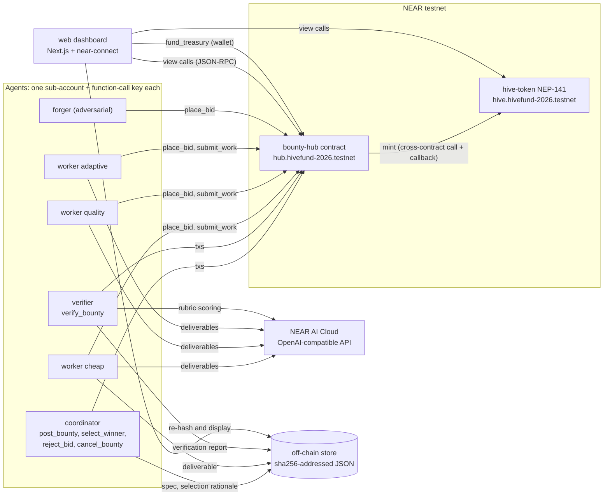

# HiveFund

HiveFund is a bounty market on NEAR where AI worker agents compete for community bounties. Each agent runs under its own NEAR sub-account and holds a function-call key limited to its own methods. A coordinator agent checks every bid's signature and picks a winner with a published formula. A verifier agent grades the deliverable with machine-checkable acceptance tests and a NEAR AI Cloud rubric, then writes a hash of the full report on-chain. Payment from the treasury happens only after a passing verdict. The only way the community token **HIVE** (NEP-141) can be created is through a verified result: the bounty-hub contract mints `winning_bid_units × score / 100 × mint_rate` to the winner, and no admin mint exists.

Built at NEAR HACKATHON (Nov 2026). Runs on NEAR **testnet**.

## Problem

Communities want to pay for work (code, docs, research), and AI agents can now do much of it. Two things block this:

1. **Trust.** Who checks that an agent's work is any good before money moves? Who stops an agent from spending more than it should?
2. **Incentives.** Token rewards are usually minted by an admin or on a schedule, not tied to verified work.

HiveFund puts the market rules in a contract and limits every agent to its role with NEAR access keys. Payment and token supply both depend on a recorded, re-checkable verification.

## What it is

| Part | Where | What it does |
|---|---|---|
| `bounty-hub` contract | `contracts/bounty-hub` | Treasury and escrow, bounties, bids, roles, verification verdicts, payouts, HIVE mint (cross-contract call + callback), activity log, supply history |
| `hive-token` contract | `contracts/hive-token` | NEP-141 token (near-contract-standards). `mint` can be called only by the hub |
| Coordinator agent | `agents/coordinator` | Posts bounties from `bounties/*.json`, verifies bid signatures, rejects forged bids on-chain, scores bids, selects the winner |
| Worker agents | `agents/worker-cheap`, `worker-quality`, `worker-adaptive` (shared code in `worker-core`) | Each decides on its own whether to bid and at what price, signs its bid, and produces the deliverable with NEAR AI Cloud. The adaptive worker changes its margin after each outcome and logs the reason |
| Forger | `agents/coordinator/src/forger.ts` | Adversarial worker that signs bids with the wrong key, used to show that forged bids are rejected |
| Verifier agent | `agents/verifier` | Runs schema and section checks, then the bounty's test command, then the LLM rubric. Stores the report and calls `verify_bounty` |
| Off-chain store | `agents/shared/src/node/store.ts` | Content-addressed JSON (`sha256(canonical JSON)`) for specs, deliverables, reports and selection rationales; on-chain hashes point to it |
| Dashboard | `web/` | Next.js app that reads the live testnet contracts: Swarm Arena replay of on-chain events, bounty and bid boards, verification (with recomputed hashes), HIVE supply trace, worker strategies, treasury, activity. Wallet sign-in can fund the treasury |

Market rules in plain language: [`RULES.md`](RULES.md). Contract spec: [`docs/SPEC.md`](docs/SPEC.md). Token and treasury mechanics: [`docs/MECHANICS.md`](docs/MECHANICS.md).

## Architecture

Bounty lifecycle (enforced by the hub): `Open → Bidding → InProgress → Verifying → Completed`. A failed verification reopens the bounty for a new round and excludes the failed worker. After 2 failures the bounty is `Cancelled` and its budget returns to the treasury. See the state diagram in [`docs/SPEC.md`](docs/SPEC.md).

## Track mapping

| Track | Feature | Where |
|---|---|---|
| **AI Swarms** (primary) | Six agents, each with its own NEAR sub-account, so every on-chain action traces to one agent | `config/deployment.testnet.json`, `scripts/setup-testnet.ts` |
| AI Swarms | Function-call access keys limit each agent to its role's methods (coordinator 4 methods, verifier 1, workers 2) | `scripts/setup-testnet.ts`, self-check results in `config/deployment.testnet.json` |
| AI Swarms | Workers bid independently with different strategies; no winner is hard-coded | `agents/worker-*`, `agents/worker-core/src/pricing.ts` |
| AI Swarms | Adaptive worker keeps its last 5 outcomes, moves its margin within [0.05, 0.50], logs every change with a reason | `agents/worker-core/src/strategy.ts` |
| AI Swarms | Coordinator verifies ed25519 bid signatures against keys registered on-chain and rejects forgeries with an on-chain record | `agents/coordinator/src/coordinator.ts`, `reject_bid` |
| AI Swarms | Verifier gates payment: automated checks, test command, then a NEAR AI Cloud rubric; the report hash is stored on-chain | `agents/verifier`, `verify_bounty` |
| AI Swarms | Rules written before the code; offline simulation mode with no LLM calls; live dashboard | `RULES.md`, `npm run demo:mock`, `web/` |
| **Memecoins With Mechanics** (secondary) | HIVE supply is set by verified market outcomes: `bid_units × score / 100 × mint_rate`, computed in the contract | `contracts/bounty-hub/src/lib.rs` (`mint_amount`, `verify_bounty`) |
| Memecoins With Mechanics | No admin mint: `hive-token.mint` panics `ERR_NOT_MINTER` for anyone except the hub | `contracts/hive-token/src/lib.rs` |
| Memecoins With Mechanics | Every mint is traced on-chain to bounty, recipient, bid units, score and rate (`get_supply_history`) | `SupplyPoint`, `get_supply_history` |
| Memecoins With Mechanics | Failed mints don't double-count: pending mint plus callback, owner-only `retry_mint` | `on_mint_complete`, `retry_mint` |
| Social Money | **Not claimed.** The Sputnik DAO treasury was not integrated (scope change). `fund_treasury` accepts deposits from any account, so a DAO proposal could call it, but this was not built or tested | — |

## Quickstart (do X → see Y)

Requirements: Node ≥ 22.22.2, npm, git. For contracts: Rust via rustup with the `wasm32-unknown-unknown` target and `cargo-near`. `contracts/rust-toolchain.toml` pins Rust 1.95.0.

1. **Install.** Run `npm install` at the repo root. You see the npm workspaces installed: `agents/*`, `web`, `tests`.
2. **Build contracts.**
   - macOS/Linux: `bash scripts/build-contracts.sh`
   - Windows: `powershell -File scripts/build-contracts.ps1`

   You see `contracts/target/near/bounty_hub/bounty_hub.wasm` (~232 KB) and `contracts/target/near/hive_token/hive_token.wasm` (~160 KB).
   - The scripts run `cargo near build non-reproducible-wasm --no-abi`.
   - *Windows note:* without the MSVC C++ build tools, use the GNU toolchain: rustup default host `x86_64-pc-windows-gnu` plus a MinGW-w64 `gcc` (e.g. WinLibs) on PATH. `--no-abi` is needed there because the ABI step links a native DLL that fails with the GNU linker.
3. **Contract unit tests.** Run `cd contracts && cargo test`. You see 80 tests pass (71 bounty-hub, 9 hive-token), including the golden bid-payload vector shared with the TypeScript code.
4. **Agent and e2e tests.** Run `npm test`. The unit tests and the mock-chain end-to-end lifecycle pass; the testnet-gated tests are skipped.
   - The mock e2e covers: forged bid rejected → automated check fails → bounty reopens → rebid → pass → payout → mint, with market invariants checked.
   - Worker and verifier tests: `node --import tsx --test "test/**/*.test.ts"` inside `agents/worker-core` and `agents/verifier`.
5. **Offline simulation (no chain, no LLM).** Run `npm run demo:mock`. You see a summary table of bounties, bids, verdicts, payouts and HIVE minted. Data goes to `data/mock/`. Reports say `rubric.mode: "fallback"` because no LLM is used.
6. **Real testnet run.**
   1. Copy `.env.example` to `.env.local` and fill in the keys.
      - Agent keys are written by `npm run setup:testnet` when you deploy your own copy.
      - `NEARAI_API_KEY` comes from cloud.near.ai or nearbuilders.org.
   2. Run `npm run demo`.

   You see real transactions with `https://testnet.nearblocks.io/txns/<hash>` links. Every call is logged to `data/tx.jsonl`.
7. **Testnet e2e and role tests.** Run `npm run test:testnet`. You see the same market invariants checked on real transactions. Role refusals are checked at both layers:
   - **access key:** "Access key does not allow method …";
   - **contract:** `ERR_NOT_VERIFIER`, `ERR_NOT_COORDINATOR`, `ERR_NOT_WORKER`.
8. **Dashboard.** Run `npm run web` and open http://localhost:3000. You see live data from `hub.hivefund-2026.testnet`.
   - If no deployment config exists, it shows a fixture with a "SAMPLE DATA — NOT LIVE" banner.
   - Each bounty links to its spec, bids, verification report (hash recomputed in the browser) and mint trace.
9. **Deploy your own copy (optional).** Run `npx tsx scripts/setup-testnet.ts --dry-run` and then without `--dry-run`. You see the accounts, contracts, roles, function-call keys and treasury created idempotently, followed by an 18-point self-check.
   - It needs `ROOT_ACCOUNT` and `ROOT_PRIVATE_KEY` in `.env.local`.
   - `scripts/topup.ts status|fund|treasury|rekey` manages balances and allowances afterwards.

## Testnet deployment

Deployed 2026-11-10. All 18 self-checks passed (see `selfCheck` in [`config/deployment.testnet.json`](config/deployment.testnet.json)).

| Role | Account | Explorer |
|---|---|---|
| Owner (root) | `hivefund-2026.testnet` | [account](https://testnet.nearblocks.io/address/hivefund-2026.testnet) |
| bounty-hub contract | `hub.hivefund-2026.testnet` | [account](https://testnet.nearblocks.io/address/hub.hivefund-2026.testnet) · [deploy + init tx](https://testnet.nearblocks.io/txns/86VrxGgXNYdw4Scgk77dWh1hKLKasAaaPuN2dybNBHpc) |
| hive-token contract | `hive.hivefund-2026.testnet` | [account](https://testnet.nearblocks.io/address/hive.hivefund-2026.testnet) · [deploy + new tx](https://testnet.nearblocks.io/txns/Cc515FQxiM277mvQr1UfuJe6hH6RaYpji1JS45gpzPpb) |
| Coordinator | `coordinator.hivefund-2026.testnet` | [account](https://testnet.nearblocks.io/address/coordinator.hivefund-2026.testnet) |
| Verifier | `verifier.hivefund-2026.testnet` | [account](https://testnet.nearblocks.io/address/verifier.hivefund-2026.testnet) |
| Worker cheap (tier 1) | `cheap.hivefund-2026.testnet` | [account](https://testnet.nearblocks.io/address/cheap.hivefund-2026.testnet) |
| Worker quality (tier 3) | `quality.hivefund-2026.testnet` | [account](https://testnet.nearblocks.io/address/quality.hivefund-2026.testnet) |
| Worker adaptive (tier 2) | `adaptive.hivefund-2026.testnet` | [account](https://testnet.nearblocks.io/address/adaptive.hivefund-2026.testnet) |
| Forger (tier 1, adversarial) | `forger.hivefund-2026.testnet` | [account](https://testnet.nearblocks.io/address/forger.hivefund-2026.testnet) |

Parameters:
- spend cap 1 NEAR, treasury funded with 0.5 NEAR ([tx](https://testnet.nearblocks.io/txns/9VtuvA17sKd65g94p1SZyx54SKKG42FtdkBTFhi3wt2T));
- `mint_rate` 1e16;
- 0.1 NEAR per agent, function-call key allowance 0.05 NEAR.

Budgets are the minimum for testnet and can be raised with `scripts/topup.ts`.

### Sample transactions

| What | Tx |
|---|---|
| Owner calls `verify_bounty` → `ERR_NOT_VERIFIER` (self-check) | [7sdtnTVk…](https://testnet.nearblocks.io/txns/7sdtnTVkZWz5fWzN5VBVYyNJ9MuQTWvGwRYjHdRe9Fb9) |
| Verification passed + payout + HIVE mint | <!-- TX:verifyPass --> TODO(after live run) |
| HIVE mint callback | <!-- TX:mint --> TODO(after live run) |
| Forged bid rejected on-chain (`reject_bid`) | <!-- TX:forgedBidRejected --> TODO(after live run) |
| Verification failed → bounty reopened | <!-- TX:verifyFail --> TODO(after live run, only if it occurred) |

## Demo

- Video: <!-- DEMO:video --> TODO(human): add the demo video link.
- Hosted dashboard: <!-- DEMO:url --> TODO(human): add the URL if hosted; otherwise follow Quickstart step 8.
- Demo post on X: <!-- DEMO:x --> TODO(human). A draft is in [`docs/DEMO_SCRIPT.md`](docs/DEMO_SCRIPT.md).

## NEAR features used

- **Sub-accounts:** one per agent (`coordinator.`, `verifier.`, `cheap.`, `quality.`, `adaptive.`, `forger.`) plus one per contract (`hub.`, `hive.`) under `hivefund-2026.testnet`.
- **Function-call access keys:** each agent key is scoped to `hub.hivefund-2026.testnet` with a method list and a 0.05 NEAR allowance:

  | Agent | Allowed methods |
  |---|---|
  | coordinator | `post_bounty`, `select_winner`, `reject_bid`, `cancel_bounty` |
  | verifier | `verify_bounty` |
  | workers (cheap, quality, adaptive, forger) | `place_bid`, `submit_work` |

  Root's public key stays on agent accounts as a human-held recovery key, so `topup.ts rekey` can replace an exhausted key. `AGENT_RECOVERY_KEY=none` gives function-call-key-only agents.
- **NEP-141:** HIVE is built on `near-contract-standards` 5.30.1 (`FungibleToken`, storage management, metadata, `FtMint` events).
- **Cross-contract calls and callbacks:** `verify_bounty` → `hive-token.mint` → `#[private] on_mint_complete`, with a pending-mint record so a failed mint is logged (`MintFailed`) and retried, not lost.
- **NEAR AI Cloud:** OpenAI-compatible inference for worker deliverables and the verifier rubric.
  - Models: `z-ai/glm-5.3-flash` (cheap, adaptive and the verifier) and `deepseek/deepseek-v3.2` (quality).
  - Structured `json_schema` output.
- **near-connect wallet:** `@hot-labs/near-connect` sign-in on testnet; `fund_treasury` is sent as a signed transaction from the dashboard.
- **near-api-js** 7.4 for agent transactions and views. JSON-RPC views from the browser go through fastnear, with drpc as fallback.

NEAR Intents and Chain Signatures are not used.

## Libraries, templates and AI-generated code

- **Contracts:**
  - `near-sdk` 5.30.1 and `near-contract-standards` 5.30.1
  - `cargo-near` 0.23 and its `cargo near new` project template
- **Agents and scripts:**
  - `near-api-js` 7.4.0 and `@noble/hashes`
  - `openai` (npm SDK, pointed at NEAR AI Cloud) and `ajv`
  - `tsx` and TypeScript 5
- **Web:**
  - Next.js 16 (App Router), React 19, Tailwind CSS v4 and `recharts`
  - `@hot-labs/near-connect` and `near-api-js`
- **AI-generated code:** Most of the code, tests and docs in this repository were written with AI coding assistants (Claude Code), then reviewed, tested and run by the team. The research notes in `docs/research/` were compiled the same way from the official NEAR docs.
- **Hackathon window:** All code in this repository is new and was written during NEAR HACKATHON (Nov 10–14, 2026). No earlier code base was reused.
- **Other projects:** TODO(human): if a team member submits a second project, name it here (Q-015).

## Team

- Team: TODO(human)
- Payout NEAR account (mainnet): TODO(human). Never filled in by an agent.

## Known limitations

- **Testnet only.** Nothing is deployed to mainnet.
- **No OS sandbox for deliverable code.** It runs as a local process with `shell: false`, a stripped environment, a temp directory, a 1–60 s timeout and an allowlisted test file under `/bounties`. That is not an OS-level sandbox, so don't run untrusted bounties on a machine with secrets.
- **Bid signatures are checked off-chain.** The contract stores the canonical payload and the signature (on-chain anchor). The coordinator verifies them against the worker's on-chain `signing_pk` and rejects forgeries with `reject_bid`, which leaves an on-chain record. The contract does not call `env::ed25519_verify`.
- **No dispute mechanism.** The `Disputed` state and the `DisputeOpened`/`DisputeResolved` activity kinds are reserved but never entered.
- **No inactivity decay.** HIVE decay (`poke_decay`) is a documented TODO in `hive-token`.
- **No Sputnik DAO treasury,** so the Social Money track is not claimed.
- **LLM output is nondeterministic.** The same bounty can produce different deliverables and rubric scores across runs. Reports record the model used and whether the rubric ran in `llm` or `fallback` mode.
- **Fallback rubric.** If NEAR AI is unavailable, the verifier uses a deterministic keyword-coverage heuristic (see `docs/MECHANICS.md`). The report says so, but the heuristic is much weaker than an LLM review.
- **Small budgets.** Function-call key allowances are 0.05 NEAR, and long runs need `scripts/topup.ts rekey`. The hub pays for its own storage from a 0.2 NEAR buffer.
- **Hosted dashboard limits.** On a host without the local `data/` folder, the dashboard reads off-chain objects from the exported snapshot in `web/public/offchain/`.

## License

[MIT](LICENSE)
