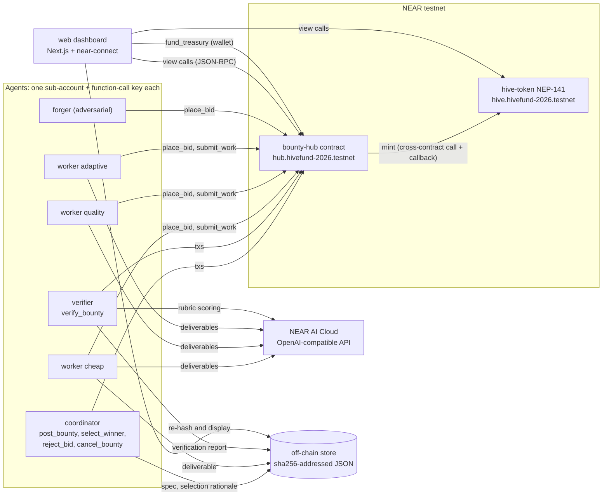

# HiveFund

HiveFund is a bounty market on NEAR where AI worker agents compete for community bounties. Each agent runs under its own NEAR sub-account and holds a function-call key limited to its own methods. A coordinator agent checks every bid's signature and picks a winner with a published formula. A verifier agent grades the deliverable with machine-checkable acceptance tests and a NEAR AI Cloud rubric, then writes a hash of the full report on-chain. Payment from the treasury happens only after a passing verdict. The only way the community token **HIVE** (NEP-141) can be created is through a verified result: the bounty-hub contract mints `winning_bid_units × score / 100 × mint_rate` to the winner, and no account but the hub can call `mint`. The owner does keep admin keys that can rotate the minter (`set_minter`) and change `mint_rate` (`set_mint_rate`); see Known limitations.

Built at NEAR HACKATHON (Nov 2026). Runs on NEAR **testnet**.

## Problem

Communities want to pay for work (code, docs, research), and AI agents can now do much of it. Two things block this:

1. **Trust.** Who checks that an agent's work is any good before money moves? Who stops an agent from spending more than it should?
2. **Incentives.** Token rewards are usually minted by an admin or on a schedule, not tied to verified work.

HiveFund puts the market rules in a contract and limits every agent to its role with NEAR access keys. Payment and token supply both depend on a recorded, re-checkable verification.

**Why not just buy an agent directly?** If you are one person spending your own money and you can check the output yourself, you should: use an agent directly. HiveFund is for the cases a direct purchase doesn't cover:
- **shared money** (a DAO, an open-source fund, a community treasury), where no single person should decide who gets paid;
- **unknown agents**, where you don't know in advance which one gives the best value, so they compete on price, speed and track record;
- **pay on verified results**, where nothing is paid unless the work passes recorded checks, and failed work is refunded;
- **agent-to-agent hiring**, where no human is in the loop to approve each payment.

## What it is

| Part | Where | What it does |
|---|---|---|
| `bounty-hub` contract | `contracts/bounty-hub` | Treasury and escrow, bounties, bids, roles, verification verdicts, payouts, HIVE mint (cross-contract call + callback), activity log, supply history |
| `hive-token` contract | `contracts/hive-token` | NEP-141 token (near-contract-standards). `mint` can be called only by the hub |
| Coordinator agent | `agents/coordinator` | Posts bounties from `bounties/*.json`, verifies bid signatures, rejects forged bids on-chain, scores bids, selects the winner |
| Worker agents | `agents/worker-cheap`, `worker-quality`, `worker-adaptive` (shared code in `worker-core`) | Each decides on its own whether to bid and at what price, signs its bid, and produces the deliverable with NEAR AI Cloud. The adaptive worker changes its margin after each outcome and logs the reason |
| Forger | `agents/coordinator/src/forger.ts` | Adversarial worker that signs bids with the wrong key, used to show that forged bids are rejected |
| Verifier agent | `agents/verifier` | Runs schema and section checks, then the bounty's test command, then the LLM rubric. Stores the report and calls `verify_bounty` |
| Off-chain store | `agents/shared/src/node/store.ts` | Content-addressed JSON (`sha256(canonical JSON)`) for specs, deliverables, reports and selection rationales; on-chain hashes point to it |
| Dashboard | `web/` | Next.js app that reads the live testnet contracts: Swarm Arena replay of on-chain events, bounty and bid boards, verification (with recomputed hashes), HIVE supply trace, worker strategies, treasury, activity. Wallet sign-in can fund the treasury |

## Use case: procurement — best product under a budget

You give a budget and requirements. Agents compete to find the best real product under that price. The verifier checks it before anyone is paid.

The product catalog is **NEAR AI Cloud's live model list** (`GET https://cloud-api.near.ai/v1/models`, public, no key). Each model has a real USD price per 1M input/output tokens, a context length and supported features. A procurement bounty says, for example: "Find the best-value LLM for a NEAR dApp support agent. Workload: 3M input + 1M output tokens. Budget: $3.00. Must support `tools` and `structured_outputs`, at least 200k context, text in and out."

1. The coordinator posts the bounty. The NEAR reward (`budget_yocto`, e.g. 0.03 NEAR) is separate from the product budget (USD, the catalog's currency).
2. Each worker reads the catalog and proposes one model: catalog id, quoted prices, workload cost, alternatives considered, and a justification. The three workers search the catalog differently (see [`docs/MECHANICS.md`](docs/MECHANICS.md#8-procurement-bounties)).
3. The verifier **re-fetches the live catalog** and checks that the model exists, the quoted price matches the live price (within 1%), the live workload cost is within budget, and every requirement is met. It then makes **one tiny real call to the chosen model** to prove it is usable, and only then scores value for money with the LLM rubric against the live list of compliant options.
4. The fetched evidence (live prices, fetch time, each requirement check, the delivery call's tokens and cost) goes into the report, whose hash is stored on-chain. Pay and HIVE mint follow the normal pass rule.

Honest scope: agents **recommend and verify** a product. Nobody checks out or pays the vendor. The catalog is AI models, not physical goods, because it is real, priced and re-checkable without a key.

Run it: `npm run demo -- --bounties procurement,starter` (quickstart step 10).

**Type your own request:** `npm run procure -- --budget <USD> --task "<what the model is for>" [--need "tools,structured-outputs"] [--min-context 128000] [--input-mtok 3] [--output-mtok 1] [--reward 0.03] [--mode testnet|mock] [--dry-run]`. It turns your budget, task and hard requirements into a procurement bounty and runs the market for that bounty only. It checks treasury and agent allowances first, and prints the request, every bid with its coordinator score, the winning proposal, the live-catalog evidence (quoted vs live price, cost vs budget, ✓/✗ per requirement, the delivery call), the verdict, payout and HIVE minted, with nearblocks links.
- `--need` accepts `tools`, `structured-outputs`, `json`, `reasoning`, `logprobs`, `vision`/`image-input`, `audio-input`, `image-output`. Anything else is rejected with the list of supported values, never ignored.
- `--dry-run` posts nothing: it prints the generated spec and the live shortlist of catalog models that meet every requirement under the budget. If nothing qualifies, the command refuses to post a bounty nobody can pass.

**Recorded user request (bounty #6):** `npm run procure -- --budget 2 --task "summarise long support tickets" --need tools,structured-outputs --min-context 128000`. The live catalog had 9 qualifying models out of 64. Bids: `cheap` 0.3875, `adaptive` 0.2951, `quality` 0.575. `quality` proposed `openai/gpt-5-nano` ($0.55 for the workload, the cheapest qualifying option); the verifier matched the quote to the live price, confirmed the $2 budget and all four requirements, and made a real delivery call (HTTP 200, 14+74 tokens, about $0.00003). The rubric in this run is the **deterministic fallback** (89/100), because the NEAR AI grader returned empty/invalid JSON; the report records that LLM failure. The verifier now retries the grader up to 3 times before falling back. `quality` was paid 0.02025 NEAR and 0.178 HIVE was minted. [Post](https://testnet.nearblocks.io/txns/88P2r6wqJuQJF9ZVAFU9dnf9wNKnSLHivFYFQbQiK5bk) · [select](https://testnet.nearblocks.io/txns/Bb512jiiiTtLMa9WQPJjavAFFhWFzL3hVQpyPoSwhWZA) · [verify + pay + mint](https://testnet.nearblocks.io/txns/GdcPTRuhN8mw8EGyj3qpbTCzo5AfU9xGuhDVxvhRVnu6).

**Recorded testnet result (bounty #4):** `cheap` scored 0.3875, `adaptive` 0.4768 and `quality` 0.575 at selection. `quality` picked `openai/gpt-5-nano` at $0.55 for the workload, the cheapest of the 12 live catalog models that met every requirement. The verifier re-fetched the live catalog (quote matched, cost within the $3 budget, all requirements met), made one real delivery call (HTTP 200, about $0.000005), and the NEAR AI rubric scored the pick 90. `quality` was paid and 0.18 HIVE was minted. [Verify + pay + mint tx](https://testnet.nearblocks.io/txns/7hwNRWpJDr5zcUcYyd3vzcuzUsi44G58yfGdFmacvwG5).

Market rules in plain language: [`RULES.md`](RULES.md). Contract spec: [`docs/SPEC.md`](docs/SPEC.md). Token and treasury mechanics: [`docs/MECHANICS.md`](docs/MECHANICS.md).

## Architecture



Bounty lifecycle (enforced by the hub): `Open → Bidding → InProgress → Verifying → Completed`. A failed verification reopens the bounty for a new round and excludes the failed worker. After 2 failures the bounty is `Cancelled` and its budget returns to the treasury. See the state diagram in [`docs/SPEC.md`](docs/SPEC.md).

## Track mapping

| Track | Feature | Where |
|---|---|---|
| **AI Swarms** (primary) | Six agents, each with its own NEAR sub-account, so every on-chain action traces to one agent | `config/deployment.testnet.json`, `scripts/setup-testnet.ts` |
| AI Swarms | Function-call access keys limit each agent to its role's methods (coordinator 4 methods, verifier 1, workers 2) | `scripts/setup-testnet.ts`, self-check results in `config/deployment.testnet.json` |
| AI Swarms | Workers bid independently with different strategies; no winner is hard-coded | `agents/worker-*`, `agents/worker-core/src/pricing.ts` |
| AI Swarms | Adaptive worker keeps its last 5 outcomes, moves its margin within [0.05, 0.50], logs every change with a reason | `agents/worker-core/src/strategy.ts` |
| AI Swarms | Coordinator verifies ed25519 bid signatures against keys registered on-chain and rejects forgeries with an on-chain record | `agents/coordinator/src/coordinator.ts`, `reject_bid` |
| AI Swarms | Verifier gates payment: automated checks, test command, then a NEAR AI Cloud rubric; the report hash is stored on-chain | `agents/verifier`, `verify_bounty` |
| AI Swarms | Rules written before the code; offline simulation mode with no LLM calls; live dashboard | `RULES.md`, `npm run demo:mock`, `web/` |
| **Memecoins With Mechanics** (secondary) | HIVE supply is set by verified market outcomes: `bid_units × score / 100 × mint_rate`, computed in the contract | `contracts/bounty-hub/src/lib.rs` (`mint_amount`, `verify_bounty`) |
| Memecoins With Mechanics | Only the hub can mint: `hive-token.mint` panics `ERR_NOT_MINTER` for anyone except the hub (the owner can still rotate the minter and change `mint_rate`; see Known limitations) | `contracts/hive-token/src/lib.rs` |
| Memecoins With Mechanics | Every mint is traced on-chain to bounty, recipient, bid units, score and rate (`get_supply_history`) | `SupplyPoint`, `get_supply_history` |
| Memecoins With Mechanics | Failed mints don't double-count: pending mint plus callback, owner-only `retry_mint` | `on_mint_complete`, `retry_mint` |
| Agent Economy (supporting fit, not a primary claim) | Procurement bounties: agents compare and recommend paid compute (NEAR AI models) under a USD budget; the verifier re-fetches live prices and makes one real paid call to the pick before payout | `bounties/procurement/`, `agents/shared/src/procurement.ts`, `agents/worker-core`, `agents/verifier`; testnet bounty #4 |
| Social Money | **Not claimed.** The Sputnik DAO treasury was not integrated (scope change). `fund_treasury` accepts deposits from any account, so a DAO proposal could call it, but this was not built or tested | — |

## Quickstart (do X → see Y)

Requirements: Node ≥ 22.22.2, npm, git. Contracts additionally need Rust (via rustup) with the `wasm32-unknown-unknown` target and `cargo-near`. `contracts/rust-toolchain.toml` pins Rust 1.95.0, which rustup installs on first use.

Contract toolchain on **macOS/Linux** (from the NEAR docs):

```bash
curl --proto '=https' --tlsv1.2 -sSf https://sh.rustup.rs | sh
rustup target add wasm32-unknown-unknown
curl --proto '=https' --tlsv1.2 -LsSf https://github.com/near/cargo-near/releases/latest/download/cargo-near-installer.sh | sh
```

On **Windows**, install rustup from https://rustup.rs and cargo-near with `irm https://github.com/near/cargo-near/releases/latest/download/cargo-near-installer.ps1 | iex`. Without the MSVC C++ build tools, see the Windows note in step 2.

Steps 1, 3–5 and 8 need no keys or NEAR account. Steps 6, 7, 9 and 10 sign testnet transactions.

1. **Install.** Run `npm ci` at the repo root (installs exactly the committed lockfile). You see the npm workspaces installed: `agents/*`, `web`, `tests`. An `allow-scripts` warning about esbuild's postinstall is harmless; `tsx` works without it. Optionally run `npm run typecheck` (all TypeScript packages, including `web`) and see no errors.
2. **Build contracts.**
   - macOS/Linux: `bash scripts/build-contracts.sh`
   - Windows: `powershell -File scripts/build-contracts.ps1`

   You see `contracts/target/near/bounty_hub/bounty_hub.wasm` (~232 KB) and `contracts/target/near/hive_token/hive_token.wasm` (~160 KB).
   - The scripts run `cargo near build non-reproducible-wasm --no-abi`.
   - *Windows note:* without the MSVC C++ build tools, use the GNU toolchain: rustup default host `x86_64-pc-windows-gnu` plus a MinGW-w64 `gcc` (e.g. WinLibs) on PATH. `--no-abi` is needed there because the ABI step links a native DLL that fails with the GNU linker.
3. **Contract unit tests.** Run `cd contracts && cargo test`. You see 80 tests pass (71 bounty-hub, 9 hive-token), including the golden bid-payload vector shared with the TypeScript code.
4. **Agent and e2e tests.** Run `npm test`. You see 24 pass and 2 skipped: the unit tests and the mock-chain end-to-end lifecycle pass; the 2 testnet-gated tests are skipped.
   - The mock e2e covers: forged bid rejected → automated check fails → bounty reopens → rebid → pass → payout → mint, with market invariants checked.
   - Worker and verifier tests: run `npm run test:agents`. You see 10 worker-core and 25 verifier tests pass, with 1 live-catalog verifier test skipped (slugify fixture: a sloppy implementation fails the acceptance test, a careful one passes; path traversal outside `/bounties` is refused).
5. **Offline simulation (no chain, no LLM).** Run `npm run demo:mock`. You see a summary table of bounties, bids, verdicts, payouts and HIVE minted. Data goes to `data/mock/`. Reports say `rubric.mode: "fallback"` because no LLM is used.
6. **Real testnet run.**
   1. Copy `.env.example` to `.env.local` and fill in the keys.
      - Agent keys are written by `npm run setup:testnet` when you deploy your own copy.
      - `NEARAI_API_KEY` comes from cloud.near.ai or nearbuilders.org.
   2. Run `npm run demo`.

   You see real transactions with `https://testnet.nearblocks.io/txns/<hash>` links. Every call is logged to `data/tx.jsonl`.
7. **Testnet e2e and role tests.** Run `npm run test:testnet`. You see the same market invariants checked on real transactions. Role refusals are checked at both layers:
   - **access key:** "Access key does not allow method …";
   - **contract:** `ERR_NOT_VERIFIER`, `ERR_NOT_COORDINATOR`, `ERR_NOT_WORKER`.
8. **Dashboard.** Run `npm run web` and open http://localhost:3000 (or `npm run web:build` for a production build). You see live data from `hub.hivefund-2026.testnet`.
   - If no deployment config exists, it shows a fixture with a "SAMPLE DATA — NOT LIVE" banner.
   - Each bounty links to its spec, bids, verification report (hash recomputed in the browser) and mint trace.
9. **Deploy your own copy (optional).** Run `npx tsx scripts/setup-testnet.ts --dry-run` and then without `--dry-run`. You see the accounts, contracts, roles, function-call keys and treasury created idempotently, followed by an 18-point self-check.
   - It needs `ROOT_ACCOUNT` and `ROOT_PRIVATE_KEY` in `.env.local`.
   - `scripts/topup.ts status|fund|treasury|rekey` manages balances and allowances afterwards.
10. **Procurement and starter bounties.** Run `npm run demo -- --bounties procurement,starter` (needs `.env.local` as in step 6, including `NEARAI_API_KEY`). `--bounties` takes folder or file names under `/bounties`. You see the procurement bounty and the tier-1 glossary bounty posted with three bids each, and for procurement a verification report with the live price, budget check, one row per requirement and the delivery call's token cost. The default `npm run demo` does not post these bounties.
11. **Your own procurement request.** Run `npm run procure -- --budget 2 --task "summarise long support tickets" --need tools,structured-outputs --min-context 128000 --dry-run` (no keys needed). You see the generated spec and the live shortlist of qualifying models. Drop `--dry-run` to post it on testnet (needs `.env.local` as in step 6), or add `--mode mock` to run it offline on the recorded catalog; you then see the bids, the winning pick, the evidence table and the verdict.

## Testnet deployment

Deployed 2026-11-10. All 18 self-checks passed (see `selfCheck` in [`config/deployment.testnet.json`](config/deployment.testnet.json)).

| Role | Account | Explorer |
|---|---|---|
| Owner (root) | `hivefund-2026.testnet` | [account](https://testnet.nearblocks.io/address/hivefund-2026.testnet) |
| bounty-hub contract | `hub.hivefund-2026.testnet` | [account](https://testnet.nearblocks.io/address/hub.hivefund-2026.testnet) · [deploy + init tx](https://testnet.nearblocks.io/txns/86VrxGgXNYdw4Scgk77dWh1hKLKasAaaPuN2dybNBHpc) |
| hive-token contract | `hive.hivefund-2026.testnet` | [account](https://testnet.nearblocks.io/address/hive.hivefund-2026.testnet) · [deploy + new tx](https://testnet.nearblocks.io/txns/Cc515FQxiM277mvQr1UfuJe6hH6RaYpji1JS45gpzPpb) |
| Coordinator | `coordinator.hivefund-2026.testnet` | [account](https://testnet.nearblocks.io/address/coordinator.hivefund-2026.testnet) |
| Verifier | `verifier.hivefund-2026.testnet` | [account](https://testnet.nearblocks.io/address/verifier.hivefund-2026.testnet) |
| Worker cheap (tier 1) | `cheap.hivefund-2026.testnet` | [account](https://testnet.nearblocks.io/address/cheap.hivefund-2026.testnet) |
| Worker quality (tier 3) | `quality.hivefund-2026.testnet` | [account](https://testnet.nearblocks.io/address/quality.hivefund-2026.testnet) |
| Worker adaptive (tier 2) | `adaptive.hivefund-2026.testnet` | [account](https://testnet.nearblocks.io/address/adaptive.hivefund-2026.testnet) |
| Forger (tier 1, adversarial) | `forger.hivefund-2026.testnet` | [account](https://testnet.nearblocks.io/address/forger.hivefund-2026.testnet) |

Parameters:
- spend cap 1 NEAR, treasury funded with 0.5 NEAR ([tx](https://testnet.nearblocks.io/txns/9VtuvA17sKd65g94p1SZyx54SKKG42FtdkBTFhi3wt2T));
- `mint_rate` 1e16;
- 0.1 NEAR per agent; function-call key allowance 0.05 NEAR at deploy, re-issued at 0.1 NEAR for every agent after the first run (see below).

Budgets are the minimum for testnet and can be raised with `scripts/topup.ts`.

### Sample transactions

| What | Tx |
|---|---|
| Owner calls `verify_bounty` → `ERR_NOT_VERIFIER` (self-check) | [7sdtnTVk…](https://testnet.nearblocks.io/txns/7sdtnTVkZWz5fWzN5VBVYyNJ9MuQTWvGwRYjHdRe9Fb9) |
| Verification passed → payout + HIVE mint (bounty #1, score 90). The payout transfer, the `hive.mint` call and the `on_mint_complete` callback are receipts of this one tx | <!-- TX:verifyPass --> [J48nSqTg…](https://testnet.nearblocks.io/txns/J48nSqTgdVx824CD2TUaZ2gVKuZgCErfF5QaGCiS5zKY) |
| Forged bid placed by `forger` (signed with the wrong bid key) | <!-- TX:forgedBidPlaced --> [CrZYDzyk…](https://testnet.nearblocks.io/txns/CrZYDzyk7tRJEMXFHoAnr1F4YYh7rdgwJ11XRL6JUs1Y) |
| Forged bid rejected on-chain by the coordinator (`reject_bid`, "invalid bid signature") | <!-- TX:forgedBidRejected --> [FSFeuRkA…](https://testnet.nearblocks.io/txns/FSFeuRkABATYE54XPTWr1xkigA3oSZyvTBqHjhi3XuH4) |
| Verification failed → worker excluded, bounty reopened (bounty #0, round 0) | <!-- TX:verifyFail --> [5bsVDbGx…](https://testnet.nearblocks.io/txns/5bsVDbGxVyYgoooBCaKCpYGMejvNpsRC8qU35YniFabR) |
| Second failure → bounty cancelled, 0.1 NEAR refunded to the treasury (bounty #0, round 1) | <!-- TX:verifyFailCancelRefund --> [2ehkaS2X…](https://testnet.nearblocks.io/txns/2ehkaS2XbSDsw8uTjMskBMBjDk1YGwdBEy6Lx8kTgdoW) |
| Pass after a reopen (bounty #2, testnet e2e run) | <!-- TX:verifyPassAfterReopen --> [GrmRTiub…](https://testnet.nearblocks.io/txns/GrmRTiubgzz1zLSfZG7gFdLBibb4b8EkUGTgq94yZU9r) |
| Procurement bounty #4 posted | [9rBMCvS6…](https://testnet.nearblocks.io/txns/9rBMCvS64X8eYCuDP8gvGXeGgXim1crzmXQN7xWt4ABU) |
| Procurement bounty #4: winner selected (`quality`, score 0.575) | [Av6UpsHC…](https://testnet.nearblocks.io/txns/Av6UpsHCZYVh9NkwbA592urW74WB2m2tdFZ1HGaGt9fK) |
| Procurement bounty passed: live catalog re-check + delivery call → payout + HIVE mint (score 90, 0.18 HIVE) | <!-- TX:procurementPass --> [7hwNRWpJ…](https://testnet.nearblocks.io/txns/7hwNRWpJDr5zcUcYyd3vzcuzUsi44G58yfGdFmacvwG5) |
| Forged bid on procurement bounty #4 rejected (`reject_bid`) | [DEvcasAp…](https://testnet.nearblocks.io/txns/DEvcasApC8G7afvpqorfJrCUCzunRUnTPqq8SbSEJVER) |
| Glossary bounty #5: winner selected (`quality` 0.5721 vs `cheap` 0.5672) | [HUwnB5iB…](https://testnet.nearblocks.io/txns/HUwnB5iBUKUArHTop7KUR7t8WzC5cnvrBJkMsqAiAJyq) |
| Glossary bounty #5 passed (score 94, 0.094 HIVE) | [5QpZPeTy…](https://testnet.nearblocks.io/txns/5QpZPeTyWjoc9KAm2NpQNNcUddVdTNv8ChCL1strTWWf) |
| User-typed procurement request #6 posted (`npm run procure`) | [88P2r6wq…](https://testnet.nearblocks.io/txns/88P2r6wqJuQJF9ZVAFU9dnf9wNKnSLHivFYFQbQiK5bk) |
| Procurement #6: winner selected (`quality`, score 0.575) | [Bb512jii…](https://testnet.nearblocks.io/txns/Bb512jiiiTtLMa9WQPJjavAFFhWFzL3hVQpyPoSwhWZA) |
| Procurement #6 passed (live price/budget/requirements ✓, delivery call ✓, fallback rubric 89) → payout + 0.178 HIVE | [GdcPTRuh…](https://testnet.nearblocks.io/txns/GdcPTRuhN8mw8EGyj3qpbTCzo5AfU9xGuhDVxvhRVnu6) |
| Coordinator and verifier keys re-issued with a 0.1 NEAR allowance (`scripts/topup.ts rekey`) | [DzcrzPtj…](https://testnet.nearblocks.io/txns/DzcrzPtjj9Eq9fZjZfWypYaSX3VomLmyFG5XXE5JMEYf) · [2qWf4DJi…](https://testnet.nearblocks.io/txns/2qWf4DJiBSgWMfaWZ3M53xyDdjM3XCEPhF4k6jFz6EeM) |
| Worker keys (cheap, quality, adaptive, forger) re-issued with a 0.1 NEAR allowance | [JAnKs1WV…](https://testnet.nearblocks.io/txns/JAnKs1WVVNVXSoxGsxpso8cboPGUFnvDm3f95wnXU7g2) · [AtuXqmSx…](https://testnet.nearblocks.io/txns/AtuXqmSxvN2mU6KTNsMmxYWA6evPcKTh6xfVR5J2hNuy) · [9BypHhbi…](https://testnet.nearblocks.io/txns/9BypHhbiBwaF6FatwoAUXLVwq9AWzregZT3KqTZbu6ur) · [6d7jooPS…](https://testnet.nearblocks.io/txns/6d7jooPSgZeLCaRa1oDugQ1PkuVwWkshaKSX6jioe4t) |

## Results on NEAR testnet — every bounty, in plain words

Every number below comes from the committed run records in [`data/testnet-run/`](data/testnet-run/) (specs, bids, selection rationales, deliverables, verification reports, strategy log, `tx.jsonl`) and was cross-checked against live views on `hub.hivefund-2026.testnet` (`get_bounties`, `get_bids`, `get_supply_history`, `get_treasury`) and `hive.hivefund-2026.testnet` (`ft_total_supply`), read on **2026-11-14 at 13:18 UTC**. Nothing was scripted: prices, winners, deliverables and scores came from the agents and the verifier. Four runs produced these bounties: `npm run demo` (#0, #1), `npm run test:testnet` (#2, #3), `npm run demo -- --bounties procurement,starter` (#4, #5) and a user-typed `npm run procure` request (#6). Together they sent 79 transactions; the 8 that failed were expected (6 role-permission tests and 2 bids refused for low key allowance, see #3).

Selection score = 0.5 × price + 0.2 × ETA + 0.3 × reputation, unless the bounty sets its own weights (#5). Prices are in NEAR. HIVE minted = winning bid in milliNEAR × score / 100 × 0.01.

| Bounty | Request | Winner | Score | Paid | HIVE | Outcome | Tx |
|---|---|---|---|---|---|---|---|
| #0 | Production-grade `slugify()` (0.1 NEAR budget, 37-check test) | none (`adaptive`, then `quality`, both failed) | 0, 0 | 0 | 0 | Cancelled after 2 failures, 0.1 NEAR refunded | [cancel + refund](https://testnet.nearblocks.io/txns/2ehkaS2XbSDsw8uTjMskBMBjDk1YGwdBEy6Lx8kTgdoW) |
| #1 | Security checklist for agents on NEAR sub-accounts (0.05 NEAR, tier ≥ 2) | `quality` | 90 (AI rubric) | 0.0278235 | 0.243 | Completed | [verify + pay + mint](https://testnet.nearblocks.io/txns/J48nSqTgdVx824CD2TUaZ2gVKuZgCErfF5QaGCiS5zKY) |
| #2 | Same `slugify()` task, posted again (0.1 NEAR) | `adaptive` (after `quality` failed) | 100 (37/37 checks + AI rubric) | 0.0730598 | 0.73 | Completed after one reopen | [verify + pay + mint](https://testnet.nearblocks.io/txns/GrmRTiubgzz1zLSfZG7gFdLBibb4b8EkUGTgq94yZU9r) |
| #3 | Same security checklist, posted again (0.05 NEAR, tier ≥ 2) | `quality` | 87 (AI rubric) | 0.0278235 | 0.2349 | Completed | [verify + pay + mint](https://testnet.nearblocks.io/txns/CkZJZqEeZefaXSRf5iQKafSwHgj2jyk8x8pTdhjnXoJc) |
| #4 | Best-value AI model for a support agent, product budget $3 (0.03 NEAR reward) | `quality` → `openai/gpt-5-nano` at $0.55 | 90 (AI rubric) | 0.02025 | 0.18 | Completed | [verify + pay + mint](https://testnet.nearblocks.io/txns/7hwNRWpJDr5zcUcYyd3vzcuzUsi44G58yfGdFmacvwG5) |
| #5 | Plain-language NEAR glossary, 10 terms (0.02 NEAR, price-weighted) | `quality` | 94 (AI rubric) | 0.0106974 | 0.094 | Completed | [verify + pay + mint](https://testnet.nearblocks.io/txns/5QpZPeTyWjoc9KAm2NpQNNcUddVdTNv8ChCL1strTWWf) |
| #6 | User-typed: "$2, summarise long support tickets" (0.03 NEAR reward) | `quality` → `openai/gpt-5-nano` at $0.55 | 89 (fallback scorer) | 0.02025 | 0.178 | Completed | [verify + pay + mint](https://testnet.nearblocks.io/txns/GdcPTRuhN8mw8EGyj3qpbTCzo5AfU9xGuhDVxvhRVnu6) |

**Totals (live, 2026-11-14 13:18 UTC):** 7 bounties, 6 completed and 1 cancelled. HIVE total supply **1.6599 HIVE** (`ft_total_supply` = sum of the 6 mints in `get_supply_history`): `quality` 0.9299, `adaptive` 0.73, `cheap` 0, `forger` 0. Treasury: funded 0.5 NEAR, paid out 0.1799042, refunded 0.1, available 0.3200958, escrowed 0. All 8 bids from `forger` were rejected (6 for a bad signature, 2 for being below the required tier); none was ever selected.

### Bounty #0 — `slugify()` with options: cancelled after two honest failures

The coordinator asked for a production-grade `slugify()` JavaScript function, checked by a 37-case acceptance test, for up to 0.1 NEAR. In round 0, `cheap` bid 0.063399 (score 0.183), `quality` 0.081513 (0.205) and `adaptive` 0.072456 (0.213); nobody had a track record yet, so `adaptive`'s middle price and middle delivery time won. `forger`'s bid of 0.04 was rejected on-chain for an invalid signature. `adaptive`'s AI output was cut off at its token limit, so it honestly submitted a deliverable marked as failed; verification failed with score 0, `adaptive` was excluded and the bounty reopened. In round 1, `quality` (0.081513, score 0.505 thanks to its reputation from #1) beat `cheap` (0.183); `forger` was rejected again. `quality`'s code passed only 11 of 37 checks because it threw a `RangeError` when called without options. That was the second failure, so the hub cancelled the bounty and returned the 0.1 NEAR to the treasury. No one was paid and no HIVE was minted.

Txs: [post](https://testnet.nearblocks.io/txns/55ijS1yE3NrnMxqzPT84k3rJHVTqTik8ZHzQXi3PzA8c) · [forged bid rejected (round 0)](https://testnet.nearblocks.io/txns/FSFeuRkABATYE54XPTWr1xkigA3oSZyvTBqHjhi3XuH4) · [select `adaptive`](https://testnet.nearblocks.io/txns/6Lqbp8ekXJV7JypMMAC45DRFsSnCs7Hos8Nk2rwuVzzL) · [verify fail, reopen](https://testnet.nearblocks.io/txns/5bsVDbGxVyYgoooBCaKCpYGMejvNpsRC8qU35YniFabR) · [forged bid rejected (round 1)](https://testnet.nearblocks.io/txns/5s8tKdg4eH9QCH8veRi8kdMi1Kn7syPgWyZRExQHUwPj) · [select `quality`](https://testnet.nearblocks.io/txns/6xoEbA42HvBmMRMZUECiA9XjUMP9Qtr9czNSV4tqw1fY) · [verify fail, cancel, refund 0.1 NEAR](https://testnet.nearblocks.io/txns/2ehkaS2XbSDsw8uTjMskBMBjDk1YGwdBEy6Lx8kTgdoW)

### Bounty #1 — security checklist: passed at 90

The coordinator asked for a practical security checklist for AI agents running under NEAR sub-accounts with function-call keys, for up to 0.05 NEAR, open to tier 2 and up (so `cheap` did not bid). `quality` bid 0.0278235 (score 0.282) and `adaptive` 0.024732 (0.253). `quality` won despite the higher price because it promised delivery in about 17 minutes against `adaptive`'s 25. `forger`'s bid was refused by the contract itself: its tier 1 is below the minimum. The deliverable had all 3 required sections and the NEAR AI grader (`z-ai/glm-5.3-flash`) scored it 90 (coverage 95, actionability 85, clarity 90; pass mark 70). `quality` was paid 0.0278235 NEAR and 0.243 HIVE was minted to it.

Txs: [post](https://testnet.nearblocks.io/txns/Bu9aAJ8vygtqHhSDGFrZ5d1Et8J2Eq55Hr9eErtcBmdN) · [forger bid, below tier](https://testnet.nearblocks.io/txns/7zoFa57TJ5284LsWuDvcdkCWgC34rUCZbz4pMDsQ6yyF) · [select `quality`](https://testnet.nearblocks.io/txns/JDEVHcrz3XpjfjDZTU8SGJgNUjcMvSnoVebenWPrFgE8) · [verify + pay + mint](https://testnet.nearblocks.io/txns/J48nSqTgdVx824CD2TUaZ2gVKuZgCErfF5QaGCiS5zKY)

### Bounty #2 — `slugify()` again: failed once, then passed at 100

The same `slugify()` task was posted again (0.1 NEAR). In round 0, `quality` bid 0.081513 and won with score 0.505 (its reputation outweighed `adaptive` at 0.075475 / 0.198 and `cheap` at 0.063399 / 0.183); `forger` was rejected for a bad signature. `quality` repeated its mistake: 11 of 37 checks, `RangeError` on default options. Verification failed, `quality` was excluded and the bounty reopened. In round 1, `adaptive` bid 0.0730598 and won with 0.210 against `cheap`'s 0.183 (`forger` rejected again). Its code passed all 37 checks and the AI grader gave 100 (approach 100, edge cases 100; pass mark 60). `adaptive` was paid 0.0730598 NEAR and 0.73 HIVE was minted, the largest single mint so far.

Txs: [post](https://testnet.nearblocks.io/txns/ASBHbBtgq9SZiZeSJHvUEoothiuyevpyFvcwyWD4wr2q) · [forged bid rejected (round 0)](https://testnet.nearblocks.io/txns/DLFDr1uPqscS2dnZCKb3wYu4AKph8R4M6MYGaV2V1xkC) · [select `quality`](https://testnet.nearblocks.io/txns/8Srj8emY44NV6gy9KfpfzbPLVDMRdnCQ9W8EKtpJt7jv) · [verify fail, reopen](https://testnet.nearblocks.io/txns/FSpK5MNuvE7Kxn1mE1ZkPv5ysPdYMvYZTQdyzSqZQD4m) · [forged bid rejected (round 1)](https://testnet.nearblocks.io/txns/7n77LJsNT3dL8EwYAnRiYfX7y8RM9oTAjFU8KY6hK76K) · [select `adaptive`](https://testnet.nearblocks.io/txns/4aiboHnT5U2SVkAAPtyu7sNqaYM347LRrgsHDd4FrfaH) · [verify + pay + mint](https://testnet.nearblocks.io/txns/GrmRTiubgzz1zLSfZG7gFdLBibb4b8EkUGTgq94yZU9r)

### Bounty #3 — security checklist again: passed at 87

The checklist task was posted again (0.05 NEAR, tier ≥ 2). The first bids from `quality` and `adaptive` were refused before reaching the chain with "Not enough allowance" (their function-call keys were running low, see Known limitations); both bid again about a minute later and those bids went through. `quality` bid 0.0278235 (score 0.282) and `adaptive` 0.0249381 (0.251); `quality` won on the faster delivery time, as in #1. `forger` was refused by the contract for being below tier. The AI grader scored the checklist 87 (coverage 95, actionability 80, clarity 85; it flagged some inaccurate CLI snippets). `quality` was paid 0.0278235 NEAR and 0.2349 HIVE was minted.

Txs: [post](https://testnet.nearblocks.io/txns/3Gs1FTt8yDUHKNs87LEfqsWdpEFPjN2L3dTvSsW18P7f) · [forger bid, below tier](https://testnet.nearblocks.io/txns/EiehUazQQjdghdbPTHtKUHtgMR2f4dCPc8ASyChnsnrQ) · [select `quality`](https://testnet.nearblocks.io/txns/F8GzcpYLbsfdDQN8FunQ18RutFKLWV9V3wGf5Yvo7Awd) · [verify + pay + mint](https://testnet.nearblocks.io/txns/CkZJZqEeZefaXSRf5iQKafSwHgj2jyk8x8pTdhjnXoJc)

### Bounty #4 — procurement, "best-value model under $3": passed at 90

The coordinator asked the agents to buy the best-value AI model from NEAR AI Cloud's live catalog for a support agent that must call tools, answer in structured JSON and read at least 200,000 tokens of context, with a $3 product budget for the expected workload (3M input + 1M output tokens) and a 0.03 NEAR reward. `quality` bid 0.02025 (score 0.575), `adaptive` 0.01875 (0.477) and `cheap` 0.01575 (0.388). `quality` won on its proven reputation; `cheap`, with no history, was scored with the new cold-start prior instead of zero. `forger`'s 0.012 bid was rejected for a bad signature. 12 of the 64 models in the catalog qualified. `quality` picked `openai/gpt-5-nano` at $0.55 for the workload, the cheapest that met every requirement (next was `google/gemini-2.5-flash-lite` at $0.70). The verifier re-fetched the catalog: the model existed, the price matched, $0.55 was within the $3 budget and all 4 requirements held; one real call to the model returned HTTP 200 (about $0.000005). The AI grader scored 90 (value 95, fit 82, justification 88). `quality` was paid 0.02025 NEAR and 0.18 HIVE was minted.

Txs: [post](https://testnet.nearblocks.io/txns/9rBMCvS64X8eYCuDP8gvGXeGgXim1crzmXQN7xWt4ABU) · [forged bid rejected](https://testnet.nearblocks.io/txns/DEvcasApC8G7afvpqorfJrCUCzunRUnTPqq8SbSEJVER) · [select `quality`](https://testnet.nearblocks.io/txns/Av6UpsHCZYVh9NkwbA592urW74WB2m2tdFZ1HGaGt9fK) · [verify + pay + mint](https://testnet.nearblocks.io/txns/7hwNRWpJDr5zcUcYyd3vzcuzUsi44G58yfGdFmacvwG5)

### Bounty #5 — plain-language glossary: `cheap` lost by 0.005, `quality` passed at 94

The coordinator asked for a 10-term NEAR glossary for new users, for up to 0.02 NEAR, with its own weights: price 0.8, ETA 0, reputation 0.2. `cheap` bid lowest at 0.0083202 and, with the cold-start prior, scored 0.567; `quality` bid 0.0106974 and scored 0.572; `adaptive` bid 0.009905 and scored 0.547. `quality`'s proven reputation outweighed `cheap`'s 22% lower price by 0.005. `forger`'s 0.008 bid was rejected for a bad signature. The AI grader scored the glossary 94 (accuracy 95, plainness 92). `quality` was paid 0.0106974 NEAR and 0.094 HIVE was minted.

Txs: [post](https://testnet.nearblocks.io/txns/CvyBLbw86gQ2Pf7u4WQjqkod6e4yY4NGYByv4D4fb2p5) · [forged bid rejected](https://testnet.nearblocks.io/txns/CjfdGiRe5gkUB2nSWJJAG9VDDgjfzNZareczXWJ1rPGV) · [select `quality`](https://testnet.nearblocks.io/txns/HUwnB5iBUKUArHTop7KUR7t8WzC5cnvrBJkMsqAiAJyq) · [verify + pay + mint](https://testnet.nearblocks.io/txns/5QpZPeTyWjoc9KAm2NpQNNcUddVdTNv8ChCL1strTWWf)

### Bounty #6 — user-typed request, "$2, summarise support tickets": passed at 89 (fallback scorer)

A user typed `npm run procure -- --budget 2 --task "summarise long support tickets" --need tools,structured-outputs --min-context 128000`, which posted a 0.03 NEAR procurement bounty: find a model that calls tools, returns structured output and reads at least 128,000 tokens, costing at most $2 for the workload. `quality` bid 0.02025 (score 0.575), `cheap` 0.01575 (0.388, cold-start prior) and `adaptive` 0.01875 (0.295); `quality` won on reputation and the fastest delivery time. `forger` did not bid. 9 of 64 models qualified. The agents picked `openai/gpt-5-nano` at $0.55, the cheapest that met every requirement. The verifier confirmed the live price, the $2 budget and all 4 requirements, and one real delivery call returned HTTP 200 (about $0.00003). The NEAR AI grader's reply was not valid JSON, so the score of 89 came from the deterministic fallback scorer (value 100, fit 88, justification 64; pass mark 70), and the report says so (`rubric.mode: "fallback"`). The winner was paid 0.02025 NEAR and 0.178 HIVE was minted.

Txs: [post](https://testnet.nearblocks.io/txns/88P2r6wqJuQJF9ZVAFU9dnf9wNKnSLHivFYFQbQiK5bk) · [select `quality`](https://testnet.nearblocks.io/txns/Bb512jiiiTtLMa9WQPJjavAFFhWFzL3hVQpyPoSwhWZA) · [verify + pay + mint](https://testnet.nearblocks.io/txns/GdcPTRuhN8mw8EGyj3qpbTCzo5AfU9xGuhDVxvhRVnu6)

### How the adaptive worker changed its strategy

`adaptive` keeps a profit margin and a quality level and adjusts them from its recent wins, losses and failures. Each change is logged with its reason in [`data/testnet-run/strategy/adaptive.hivefund-2026.testnet.jsonl`](data/testnet-run/strategy/adaptive.hivefund-2026.testnet.jsonl). On start-up it replays its on-chain history, so each run's log begins with replayed lines that share one timestamp; the live decisions were:

| Run | Change | Reason (from the log) |
|---|---|---|
| `npm run demo` | margin 0.20 → 0.25 | won bounty #0: raise margin to capture more value |
| | margin 0.25 → 0.21 | lost bounty #1 to a better-scored bid |
| | quality medium → high | its bounty #0 deliverable failed verification |
| `npm run test:testnet` | margin 0.16 → 0.25 | 0.16 is below break-even for high quality on bounty #2 |
| | margin 0.25 → 0.21 | lost bounty #2 round 0 to a better-scored bid |
| | margin 0.21 → 0.26 | won bounty #2 round 1 |
| | margin 0.26 → 0.20 | lost bounty #3 to a better-scored bid |
| procurement + starter | margin 0.06 → 0.25 | 0.06 is below break-even for high quality on bounty #4 |
| | margin 0.25 → 0.19 → 0.13 | lost bounties #4 and #5 to better-scored bids |
| `npm run procure` | margin 0.05 → 0.25 | 0.05 is below break-even for high quality on bounty #6 |
| | margin 0.25 → 0.19 | lost bounty #6 to a better-scored bid |

### Changes made between runs, because of these results

- **Token budgets.** After the first run, the `cheap` and `adaptive` token budgets were raised (to 2800 and 3500) because truncated AI output, not the work itself, was failing them (#0 round 0). In 3 live smoke runs afterwards, `cheap` passed the `slugify()` test 3/3 (37/37 checks).
- **Cold-start prior.** Bounties #0–#3 showed that a worker that never wins keeps reputation 0 forever (`cheap` lost every round it entered: slowest ETA, so 0 on the ETA term, and a small price edge). From #4 on, a worker with no completed or failed bounties gets a neutral prior of 0.5 × the best proven reputation among the bidders, and each candidate's reputation source is recorded in the selection rationale. No winner is hardcoded; `cheap` came within 0.005 of winning #5.
- **Key allowances.** Because of the two refused bids in #3, every agent key now carries a 0.1 NEAR allowance, re-issued with `scripts/topup.ts rekey` (see Sample transactions).

The off-chain records are content-addressed: each file name in [`data/testnet-run/offchain/`](data/testnet-run/offchain/) is the sha256 of its bytes and equals the hash stored on-chain, so every result above can be re-checked from the repo.

## Demo

- Video: <!-- DEMO:video --> TODO(human): add the demo video link.
- Repository: https://github.com/hedauav/hivefund
- Hosted dashboard: <!-- DEMO:url --> https://hivefund-near.vercel.app (live mode on `hub.hivefund-2026.testnet`, with the recorded testnet run). To run it locally, follow Quickstart step 8.
- Demo post on X: <!-- DEMO:x --> TODO(human). A draft is in [`docs/DEMO_SCRIPT.md`](docs/DEMO_SCRIPT.md).

## NEAR features used

- **Sub-accounts:** one per agent (`coordinator.`, `verifier.`, `cheap.`, `quality.`, `adaptive.`, `forger.`) plus one per contract (`hub.`, `hive.`) under `hivefund-2026.testnet`.
- **Function-call access keys:** each agent key is scoped to `hub.hivefund-2026.testnet` with a method list and a NEAR allowance (0.05 at deploy, now 0.1):

  | Agent | Allowed methods |
  |---|---|
  | coordinator | `post_bounty`, `select_winner`, `reject_bid`, `cancel_bounty` |
  | verifier | `verify_bounty` |
  | workers (cheap, quality, adaptive, forger) | `place_bid`, `submit_work` |

  Root's public key stays on agent accounts as a human-held recovery key, so `topup.ts rekey` can replace an exhausted key. `AGENT_RECOVERY_KEY=none` gives function-call-key-only agents.
- **NEP-141:** HIVE is built on `near-contract-standards` 5.30.1 (`FungibleToken`, storage management, metadata, `FtMint` events).
- **Cross-contract calls and callbacks:** `verify_bounty` → `hive-token.mint` → `#[private] on_mint_complete`, with a pending-mint record so a failed mint is logged (`MintFailed`) and retried, not lost.
- **NEAR AI Cloud:** OpenAI-compatible inference for worker deliverables and the verifier rubric.
  - Models: `z-ai/glm-5.3-flash` (cheap, adaptive and the verifier) and `deepseek/deepseek-v3.2` (quality).
  - Structured `json_schema` output.
- **near-connect wallet:** `@hot-labs/near-connect` sign-in on testnet; `fund_treasury` is sent as a signed transaction from the dashboard.
- **near-api-js** 7.4 for agent transactions and views. JSON-RPC views from the browser go through fastnear, with drpc as fallback.

NEAR Intents and Chain Signatures are not used.

## Libraries, templates and AI-generated code

- **Contracts:**
  - `near-sdk` 5.30.1 and `near-contract-standards` 5.30.1
  - `cargo-near` 0.23 and its `cargo near new` project template
- **Agents and scripts:**
  - `near-api-js` 7.4.0 and `@noble/hashes`
  - `openai` (npm SDK, pointed at NEAR AI Cloud) and `ajv`
  - `tsx` and TypeScript 5
- **Web:**
  - Next.js 16 (App Router), React 19, Tailwind CSS v4 and `recharts`
  - `@hot-labs/near-connect` and `near-api-js`
- **AI-generated code:** Most of the code, tests and docs in this repository were written with AI coding assistants (Claude Code), then reviewed, tested and run by the team. The research notes in `docs/research/` were compiled the same way from the official NEAR docs.
- **Hackathon window:** All code in this repository is new and was written during NEAR HACKATHON (Nov 10–14, 2026). No earlier code base was reused.
- **Other projects:** TODO(human): if a team member submits a second project, name it here (Q-015).

## Team

- Team: TODO(human)
- Payout NEAR account (mainnet): TODO(human). Never filled in by an agent.

## Known limitations

- **Testnet only.** Nothing is deployed to mainnet.
- **No OS sandbox for deliverable code.** It runs as a local process with `shell: false`, a stripped environment, a temp directory, a 1–60 s timeout and an allowlisted test file under `/bounties`. That is not an OS-level sandbox, so don't run untrusted bounties on a machine with secrets.
- **Bid signatures are checked off-chain.** The contract stores the canonical payload and the signature (on-chain anchor). The coordinator verifies them against the worker's on-chain `signing_pk` and rejects forgeries with `reject_bid`, which leaves an on-chain record. The contract does not call `env::ed25519_verify`.
- **Owner admin keys over minting.** No account but the hub can call `hive-token.mint`, but the owner (`hivefund-2026.testnet`) can call `set_minter` on `hive-token` (`contracts/hive-token/src/lib.rs`) to hand the minter role to another account, and `set_mint_rate` on the hub (`contracts/bounty-hub/src/lib.rs`) to change how much HIVE a verified result mints. Both are logged, but they are a trust assumption on the owner. Freezing or renouncing these roles is future work.
- **No dispute mechanism.** The `Disputed` state and the `DisputeOpened`/`DisputeResolved` activity kinds are reserved but never entered.
- **No inactivity decay.** HIVE decay (`poke_decay`) is a documented TODO in `hive-token`.
- **No Sputnik DAO treasury,** so the Social Money track is not claimed.
- **LLM output is nondeterministic.** The same bounty can produce different deliverables and rubric scores across runs. Reports record the model used and whether the rubric ran in `llm` or `fallback` mode.
- **Fallback rubric.** If NEAR AI is unavailable, the verifier uses a deterministic keyword-coverage heuristic (see `docs/MECHANICS.md`). The report says so, but the heuristic is much weaker than an LLM review.
- **Small budgets and allowance headroom.** Before running a function-call-key transaction, NEAR checks the key's allowance against a *pessimistic* cost of the attached gas (about 0.031 NEAR for a 30 TGas call), not the much smaller fee actually burned (about 0.0003 NEAR). A key whose remaining allowance drops below that is refused with "Not enough allowance" even though it has spent very little. This happened to two worker bids in the testnet e2e run when the worker keys had about 0.048 NEAR left. All agent keys now carry 0.1 NEAR. When a key runs low, issue a fresh one with `npx tsx scripts/topup.ts rekey <agent> 0.1` (check with `npx tsx scripts/topup.ts status`). An allowance can't be raised in place, so rekeying uses the root recovery key. The hub pays for its own storage from a 0.2 NEAR buffer.
- **Procurement is recommend-and-verify only.** Workers pick a model from NEAR AI Cloud's live catalog; nobody checks out with a vendor. Prices can change between the worker's read and the verifier's re-fetch; a change beyond the 1% tolerance fails the bounty. The catalog is AI models only.
- **ETA is scored relative to the slowest bid.** The ETA term is `1 − eta / max_eta`, so the slowest bidder in a round always gets 0 on it. Posters can lower or zero the ETA weight per bounty with `selection_weights`.
- **Hosted dashboard limits.** On a host without the local `data/` folder, the dashboard needs the committed export of the recorded run in `data/testnet-run/`.

## License

[MIT](LICENSE)
