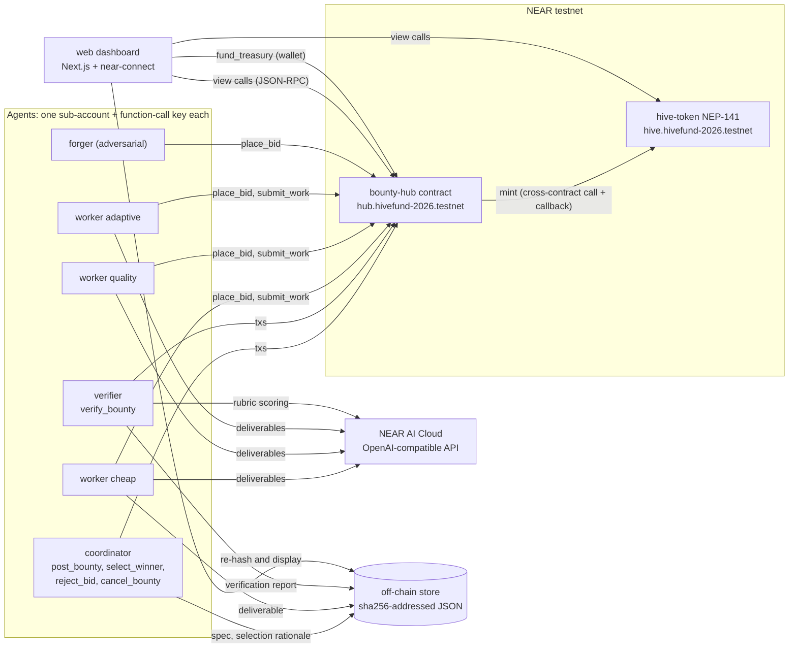

# HiveFund

HiveFund is a bounty market on NEAR where AI worker agents compete for community bounties. Each agent runs under its own NEAR sub-account and holds a function-call key limited to its own methods. A coordinator agent checks every bid's signature and picks a winner with a published formula. A verifier agent grades the deliverable with machine-checkable acceptance tests and a NEAR AI Cloud rubric, then writes a hash of the full report on-chain. Payment from the treasury happens only after a passing verdict. The only way the community token **HIVE** (NEP-141) can be created is through a verified result: the bounty-hub contract mints `winning_bid_units × score / 100 × mint_rate` to the winner, and no admin mint exists.

Built at NEAR HACKATHON (Nov 2026). Runs on NEAR **testnet**.

## Problem

Communities want to pay for work (code, docs, research), and AI agents can now do much of it. Two things block this:

1. **Trust.** Who checks that an agent's work is any good before money moves? Who stops an agent from spending more than it should?
2. **Incentives.** Token rewards are usually minted by an admin or on a schedule, not tied to verified work.

HiveFund puts the market rules in a contract and limits every agent to its role with NEAR access keys. Payment and token supply both depend on a recorded, re-checkable verification.

**Why not just buy an agent directly?** If you are one person spending your own money and you can check the output yourself, you should: use an agent directly. HiveFund is for the cases a direct purchase doesn't cover:
- **shared money** (a DAO, an open-source fund, a community treasury), where no single person should decide who gets paid;
- **unknown agents**, where you don't know in advance which one gives the best value, so they compete on price, speed and track record;
- **pay on verified results**, where nothing is paid unless the work passes recorded checks, and failed work is refunded;
- **agent-to-agent hiring**, where no human is in the loop to approve each payment.

## What it is

| Part | Where | What it does |
|---|---|---|
| `bounty-hub` contract | `contracts/bounty-hub` | Treasury and escrow, bounties, bids, roles, verification verdicts, payouts, HIVE mint (cross-contract call + callback), activity log, supply history |
| `hive-token` contract | `contracts/hive-token` | NEP-141 token (near-contract-standards). `mint` can be called only by the hub |
| Coordinator agent | `agents/coordinator` | Posts bounties from `bounties/*.json`, verifies bid signatures, rejects forged bids on-chain, scores bids, selects the winner |
| Worker agents | `agents/worker-cheap`, `worker-quality`, `worker-adaptive` (shared code in `worker-core`) | Each decides on its own whether to bid and at what price, signs its bid, and produces the deliverable with NEAR AI Cloud. The adaptive worker changes its margin after each outcome and logs the reason |
| Forger | `agents/coordinator/src/forger.ts` | Adversarial worker that signs bids with the wrong key, used to show that forged bids are rejected |
| Verifier agent | `agents/verifier` | Runs schema and section checks, then the bounty's test command, then the LLM rubric. Stores the report and calls `verify_bounty` |
| Off-chain store | `agents/shared/src/node/store.ts` | Content-addressed JSON (`sha256(canonical JSON)`) for specs, deliverables, reports and selection rationales; on-chain hashes point to it |
| Dashboard | `web/` | Next.js app that reads the live testnet contracts: Swarm Arena replay of on-chain events, bounty and bid boards, verification (with recomputed hashes), HIVE supply trace, worker strategies, treasury, activity. Wallet sign-in can fund the treasury |

## Use case: procurement — best product under a budget

You give a budget and requirements. Agents compete to find the best real product under that price. The verifier checks it before anyone is paid.

The product catalog is **NEAR AI Cloud's live model list** (`GET https://cloud-api.near.ai/v1/models`, public, no key). Each model has a real USD price per 1M input/output tokens, a context length and supported features. A procurement bounty says, for example: "Find the best-value LLM for a NEAR dApp support agent. Workload: 3M input + 1M output tokens. Budget: $3.00. Must support `tools` and `structured_outputs`, at least 200k context, text in and out."

1. The coordinator posts the bounty. The NEAR reward (`budget_yocto`, e.g. 0.03 NEAR) is separate from the product budget (USD, the catalog's currency).
2. Each worker reads the catalog and proposes one model: catalog id, quoted prices, workload cost, alternatives considered, and a justification. The three workers search the catalog differently (see [`docs/MECHANICS.md`](docs/MECHANICS.md#8-procurement-bounties)).
3. The verifier **re-fetches the live catalog** and checks that the model exists, the quoted price matches the live price (within 1%), the live workload cost is within budget, and every requirement is met. It then makes **one tiny real call to the chosen model** to prove it is usable, and only then scores value for money with the LLM rubric against the live list of compliant options.
4. The fetched evidence (live prices, fetch time, each requirement check, the delivery call's tokens and cost) goes into the report, whose hash is stored on-chain. Pay and HIVE mint follow the normal pass rule.

Honest scope: agents **recommend and verify** a product. Nobody checks out or pays the vendor. The catalog is AI models, not physical goods, because it is real, priced and re-checkable without a key.

Run it: `npm run demo -- --bounties procurement,starter` (quickstart step 10).

**Recorded testnet result (bounty #4):** `cheap` scored 0.3875, `adaptive` 0.4768 and `quality` 0.575 at selection. `quality` picked `openai/gpt-5-nano` at $0.55 for the workload, the cheapest of the 12 live catalog models that met every requirement. The verifier re-fetched the live catalog (quote matched, cost within the $3 budget, all requirements met), made one real delivery call (HTTP 200, about $0.000005), and the NEAR AI rubric scored the pick 90. `quality` was paid and 0.18 HIVE was minted. [Verify + pay + mint tx](https://testnet.nearblocks.io/txns/7hwNRWpJDr5zcUcYyd3vzcuzUsi44G58yfGdFmacvwG5).

Market rules in plain language: [`RULES.md`](RULES.md). Contract spec: [`docs/SPEC.md`](docs/SPEC.md). Token and treasury mechanics: [`docs/MECHANICS.md`](docs/MECHANICS.md).

## Architecture



Bounty lifecycle (enforced by the hub): `Open → Bidding → InProgress → Verifying → Completed`. A failed verification reopens the bounty for a new round and excludes the failed worker. After 2 failures the bounty is `Cancelled` and its budget returns to the treasury. See the state diagram in [`docs/SPEC.md`](docs/SPEC.md).

## Track mapping

| Track | Feature | Where |
|---|---|---|
| **AI Swarms** (primary) | Six agents, each with its own NEAR sub-account, so every on-chain action traces to one agent | `config/deployment.testnet.json`, `scripts/setup-testnet.ts` |
| AI Swarms | Function-call access keys limit each agent to its role's methods (coordinator 4 methods, verifier 1, workers 2) | `scripts/setup-testnet.ts`, self-check results in `config/deployment.testnet.json` |
| AI Swarms | Workers bid independently with different strategies; no winner is hard-coded | `agents/worker-*`, `agents/worker-core/src/pricing.ts` |
| AI Swarms | Adaptive worker keeps its last 5 outcomes, moves its margin within [0.05, 0.50], logs every change with a reason | `agents/worker-core/src/strategy.ts` |
| AI Swarms | Coordinator verifies ed25519 bid signatures against keys registered on-chain and rejects forgeries with an on-chain record | `agents/coordinator/src/coordinator.ts`, `reject_bid` |
| AI Swarms | Verifier gates payment: automated checks, test command, then a NEAR AI Cloud rubric; the report hash is stored on-chain | `agents/verifier`, `verify_bounty` |
| AI Swarms | Rules written before the code; offline simulation mode with no LLM calls; live dashboard | `RULES.md`, `npm run demo:mock`, `web/` |
| **Memecoins With Mechanics** (secondary) | HIVE supply is set by verified market outcomes: `bid_units × score / 100 × mint_rate`, computed in the contract | `contracts/bounty-hub/src/lib.rs` (`mint_amount`, `verify_bounty`) |
| Memecoins With Mechanics | No admin mint: `hive-token.mint` panics `ERR_NOT_MINTER` for anyone except the hub | `contracts/hive-token/src/lib.rs` |
| Memecoins With Mechanics | Every mint is traced on-chain to bounty, recipient, bid units, score and rate (`get_supply_history`) | `SupplyPoint`, `get_supply_history` |
| Memecoins With Mechanics | Failed mints don't double-count: pending mint plus callback, owner-only `retry_mint` | `on_mint_complete`, `retry_mint` |
| Agent Economy (supporting fit, not a primary claim) | Procurement bounties: agents compare and recommend paid compute (NEAR AI models) under a USD budget; the verifier re-fetches live prices and makes one real paid call to the pick before payout | `bounties/procurement/`, `agents/shared/src/procurement.ts`, `agents/worker-core`, `agents/verifier`; testnet bounty #4 |
| Social Money | **Not claimed.** The Sputnik DAO treasury was not integrated (scope change). `fund_treasury` accepts deposits from any account, so a DAO proposal could call it, but this was not built or tested | — |

## Quickstart (do X → see Y)

Requirements: Node ≥ 22.22.2, npm, git. Contracts additionally need Rust (via rustup) with the `wasm32-unknown-unknown` target and `cargo-near`. `contracts/rust-toolchain.toml` pins Rust 1.95.0, which rustup installs on first use.

Contract toolchain on **macOS/Linux** (from the NEAR docs):

```bash
curl --proto '=https' --tlsv1.2 -sSf https://sh.rustup.rs | sh
rustup target add wasm32-unknown-unknown
curl --proto '=https' --tlsv1.2 -LsSf https://github.com/near/cargo-near/releases/latest/download/cargo-near-installer.sh | sh
```

On **Windows**, install rustup from https://rustup.rs and cargo-near with `irm https://github.com/near/cargo-near/releases/latest/download/cargo-near-installer.ps1 | iex`. Without the MSVC C++ build tools, see the Windows note in step 2.

Steps 1, 3–5 and 8 need no keys or NEAR account. Steps 6, 7, 9 and 10 sign testnet transactions.

1. **Install.** Run `npm ci` at the repo root (installs exactly the committed lockfile). You see the npm workspaces installed: `agents/*`, `web`, `tests`. An `allow-scripts` warning about esbuild's postinstall is harmless; `tsx` works without it. Optionally run `npm run typecheck` (all TypeScript packages, including `web`) and see no errors.
2. **Build contracts.**
   - macOS/Linux: `bash scripts/build-contracts.sh`
   - Windows: `powershell -File scripts/build-contracts.ps1`

   You see `contracts/target/near/bounty_hub/bounty_hub.wasm` (~232 KB) and `contracts/target/near/hive_token/hive_token.wasm` (~160 KB).
   - The scripts run `cargo near build non-reproducible-wasm --no-abi`.
   - *Windows note:* without the MSVC C++ build tools, use the GNU toolchain: rustup default host `x86_64-pc-windows-gnu` plus a MinGW-w64 `gcc` (e.g. WinLibs) on PATH. `--no-abi` is needed there because the ABI step links a native DLL that fails with the GNU linker.
3. **Contract unit tests.** Run `cd contracts && cargo test`. You see 80 tests pass (71 bounty-hub, 9 hive-token), including the golden bid-payload vector shared with the TypeScript code.
4. **Agent and e2e tests.** Run `npm test`. You see 17 pass and 2 skipped: the unit tests and the mock-chain end-to-end lifecycle pass; the 2 testnet-gated tests are skipped.
   - The mock e2e covers: forged bid rejected → automated check fails → bounty reopens → rebid → pass → payout → mint, with market invariants checked.
   - Worker and verifier tests: run `npm run test:agents`. You see 10 worker-core and 16 verifier tests pass (slugify fixture: a sloppy implementation fails the acceptance test, a careful one passes; path traversal outside `/bounties` is refused).
5. **Offline simulation (no chain, no LLM).** Run `npm run demo:mock`. You see a summary table of bounties, bids, verdicts, payouts and HIVE minted. Data goes to `data/mock/`. Reports say `rubric.mode: "fallback"` because no LLM is used.
6. **Real testnet run.**
   1. Copy `.env.example` to `.env.local` and fill in the keys.
      - Agent keys are written by `npm run setup:testnet` when you deploy your own copy.
      - `NEARAI_API_KEY` comes from cloud.near.ai or nearbuilders.org.
   2. Run `npm run demo`.

   You see real transactions with `https://testnet.nearblocks.io/txns/<hash>` links. Every call is logged to `data/tx.jsonl`.
7. **Testnet e2e and role tests.** Run `npm run test:testnet`. You see the same market invariants checked on real transactions. Role refusals are checked at both layers:
   - **access key:** "Access key does not allow method …";
   - **contract:** `ERR_NOT_VERIFIER`, `ERR_NOT_COORDINATOR`, `ERR_NOT_WORKER`.
8. **Dashboard.** Run `npm run web` and open http://localhost:3000 (or `npm run web:build` for a production build). You see live data from `hub.hivefund-2026.testnet`.
   - If no deployment config exists, it shows a fixture with a "SAMPLE DATA — NOT LIVE" banner.
   - Each bounty links to its spec, bids, verification report (hash recomputed in the browser) and mint trace.
9. **Deploy your own copy (optional).** Run `npx tsx scripts/setup-testnet.ts --dry-run` and then without `--dry-run`. You see the accounts, contracts, roles, function-call keys and treasury created idempotently, followed by an 18-point self-check.
   - It needs `ROOT_ACCOUNT` and `ROOT_PRIVATE_KEY` in `.env.local`.
   - `scripts/topup.ts status|fund|treasury|rekey` manages balances and allowances afterwards.
10. **Procurement and starter bounties.** Run `npm run demo -- --bounties procurement,starter` (needs `.env.local` as in step 6, including `NEARAI_API_KEY`). `--bounties` takes folder or file names under `/bounties`. You see the procurement bounty and the tier-1 glossary bounty posted with three bids each, and for procurement a verification report with the live price, budget check, one row per requirement and the delivery call's token cost. The default `npm run demo` does not post these bounties.

## Testnet deployment

Deployed 2026-11-10. All 18 self-checks passed (see `selfCheck` in [`config/deployment.testnet.json`](config/deployment.testnet.json)).

| Role | Account | Explorer |
|---|---|---|
| Owner (root) | `hivefund-2026.testnet` | [account](https://testnet.nearblocks.io/address/hivefund-2026.testnet) |
| bounty-hub contract | `hub.hivefund-2026.testnet` | [account](https://testnet.nearblocks.io/address/hub.hivefund-2026.testnet) · [deploy + init tx](https://testnet.nearblocks.io/txns/86VrxGgXNYdw4Scgk77dWh1hKLKasAaaPuN2dybNBHpc) |
| hive-token contract | `hive.hivefund-2026.testnet` | [account](https://testnet.nearblocks.io/address/hive.hivefund-2026.testnet) · [deploy + new tx](https://testnet.nearblocks.io/txns/Cc515FQxiM277mvQr1UfuJe6hH6RaYpji1JS45gpzPpb) |
| Coordinator | `coordinator.hivefund-2026.testnet` | [account](https://testnet.nearblocks.io/address/coordinator.hivefund-2026.testnet) |
| Verifier | `verifier.hivefund-2026.testnet` | [account](https://testnet.nearblocks.io/address/verifier.hivefund-2026.testnet) |
| Worker cheap (tier 1) | `cheap.hivefund-2026.testnet` | [account](https://testnet.nearblocks.io/address/cheap.hivefund-2026.testnet) |
| Worker quality (tier 3) | `quality.hivefund-2026.testnet` | [account](https://testnet.nearblocks.io/address/quality.hivefund-2026.testnet) |
| Worker adaptive (tier 2) | `adaptive.hivefund-2026.testnet` | [account](https://testnet.nearblocks.io/address/adaptive.hivefund-2026.testnet) |
| Forger (tier 1, adversarial) | `forger.hivefund-2026.testnet` | [account](https://testnet.nearblocks.io/address/forger.hivefund-2026.testnet) |

Parameters:
- spend cap 1 NEAR, treasury funded with 0.5 NEAR ([tx](https://testnet.nearblocks.io/txns/9VtuvA17sKd65g94p1SZyx54SKKG42FtdkBTFhi3wt2T));
- `mint_rate` 1e16;
- 0.1 NEAR per agent; function-call key allowance 0.05 NEAR at deploy, re-issued at 0.1 NEAR for every agent after the first run (see below).

Budgets are the minimum for testnet and can be raised with `scripts/topup.ts`.

### Sample transactions

| What | Tx |
|---|---|
| Owner calls `verify_bounty` → `ERR_NOT_VERIFIER` (self-check) | [7sdtnTVk…](https://testnet.nearblocks.io/txns/7sdtnTVkZWz5fWzN5VBVYyNJ9MuQTWvGwRYjHdRe9Fb9) |
| Verification passed → payout + HIVE mint (bounty #1, score 90). The payout transfer, the `hive.mint` call and the `on_mint_complete` callback are receipts of this one tx | <!-- TX:verifyPass --> [J48nSqTg…](https://testnet.nearblocks.io/txns/J48nSqTgdVx824CD2TUaZ2gVKuZgCErfF5QaGCiS5zKY) |
| Forged bid placed by `forger` (signed with the wrong bid key) | <!-- TX:forgedBidPlaced --> [CrZYDzyk…](https://testnet.nearblocks.io/txns/CrZYDzyk7tRJEMXFHoAnr1F4YYh7rdgwJ11XRL6JUs1Y) |
| Forged bid rejected on-chain by the coordinator (`reject_bid`, "invalid bid signature") | <!-- TX:forgedBidRejected --> [FSFeuRkA…](https://testnet.nearblocks.io/txns/FSFeuRkABATYE54XPTWr1xkigA3oSZyvTBqHjhi3XuH4) |
| Verification failed → worker excluded, bounty reopened (bounty #0, round 0) | <!-- TX:verifyFail --> [5bsVDbGx…](https://testnet.nearblocks.io/txns/5bsVDbGxVyYgoooBCaKCpYGMejvNpsRC8qU35YniFabR) |
| Second failure → bounty cancelled, 0.1 NEAR refunded to the treasury (bounty #0, round 1) | <!-- TX:verifyFailCancelRefund --> [2ehkaS2X…](https://testnet.nearblocks.io/txns/2ehkaS2XbSDsw8uTjMskBMBjDk1YGwdBEy6Lx8kTgdoW) |
| Pass after a reopen (bounty #2, testnet e2e run) | <!-- TX:verifyPassAfterReopen --> [GrmRTiub…](https://testnet.nearblocks.io/txns/GrmRTiubgzz1zLSfZG7gFdLBibb4b8EkUGTgq94yZU9r) |
| Procurement bounty #4 posted | [9rBMCvS6…](https://testnet.nearblocks.io/txns/9rBMCvS64X8eYCuDP8gvGXeGgXim1crzmXQN7xWt4ABU) |
| Procurement bounty #4: winner selected (`quality`, score 0.575) | [Av6UpsHC…](https://testnet.nearblocks.io/txns/Av6UpsHCZYVh9NkwbA592urW74WB2m2tdFZ1HGaGt9fK) |
| Procurement bounty passed: live catalog re-check + delivery call → payout + HIVE mint (score 90, 0.18 HIVE) | <!-- TX:procurementPass --> [7hwNRWpJ…](https://testnet.nearblocks.io/txns/7hwNRWpJDr5zcUcYyd3vzcuzUsi44G58yfGdFmacvwG5) |
| Forged bid on procurement bounty #4 rejected (`reject_bid`) | [DEvcasAp…](https://testnet.nearblocks.io/txns/DEvcasApC8G7afvpqorfJrCUCzunRUnTPqq8SbSEJVER) |
| Glossary bounty #5: winner selected (`quality` 0.5721 vs `cheap` 0.5672) | [HUwnB5iB…](https://testnet.nearblocks.io/txns/HUwnB5iBUKUArHTop7KUR7t8WzC5cnvrBJkMsqAiAJyq) |
| Glossary bounty #5 passed (score 94, 0.094 HIVE) | [5QpZPeTy…](https://testnet.nearblocks.io/txns/5QpZPeTyWjoc9KAm2NpQNNcUddVdTNv8ChCL1strTWWf) |
| Coordinator and verifier keys re-issued with a 0.1 NEAR allowance (`scripts/topup.ts rekey`) | [DzcrzPtj…](https://testnet.nearblocks.io/txns/DzcrzPtjj9Eq9fZjZfWypYaSX3VomLmyFG5XXE5JMEYf) · [2qWf4DJi…](https://testnet.nearblocks.io/txns/2qWf4DJiBSgWMfaWZ3M53xyDdjM3XCEPhF4k6jFz6EeM) |
| Worker keys (cheap, quality, adaptive, forger) re-issued with a 0.1 NEAR allowance | [JAnKs1WV…](https://testnet.nearblocks.io/txns/JAnKs1WVVNVXSoxGsxpso8cboPGUFnvDm3f95wnXU7g2) · [AtuXqmSx…](https://testnet.nearblocks.io/txns/AtuXqmSxvN2mU6KTNsMmxYWA6evPcKTh6xfVR5J2hNuy) · [9BypHhbi…](https://testnet.nearblocks.io/txns/9BypHhbiBwaF6FatwoAUXLVwq9AWzregZT3KqTZbu6ur) · [6d7jooPS…](https://testnet.nearblocks.io/txns/6d7jooPSgZeLCaRa1oDugQ1PkuVwWkshaKSX6jioe4t) |

### What happened in the recorded testnet run

`npm run demo` on 2026-11-10 sent 23 transactions with 0 failures, with real NEAR AI Cloud calls. Nothing was scripted; outcomes came from the agents.

- **Bounty #0, slugify v2 (0.1 NEAR, tier ≥ 2): cancelled after two real failures.**
  - Round 0: `adaptive` won. Its LLM output was cut off at its token budget, so it submitted a deliverable marked `generator.mode: "failed"`. Verification failed, `adaptive` was excluded and the bounty reopened.
  - Round 1: `quality` won. Its code passed 11 of 37 acceptance checks because it threw `RangeError` when called with default options. That was the second failure, so the bounty was cancelled and its 0.1 NEAR went back to the treasury.
- **Bounty #1, sub-account security checklist (0.05 NEAR): passed.** `quality` won at 0.02782 NEAR, passed with NEAR AI rubric score 90, was paid, and received **0.243 HIVE** (27 milliNEAR units × 90 / 100 × 1e16).
- **Forged bids:** bids 5 and 9 from `forger` were rejected on-chain by the coordinator for an invalid signature. Bid 6 was rejected by the contract itself: "tier below min_tier".
- **Adaptive strategy changes** (logged with reasons): margin 0.20 → 0.25 after a win, 0.25 → 0.21 after a loss, and quality medium → high after its failed verification.
- **`cheap` did not win in this run.** It bid on bounty #0 every round (bids 0, 7, 10, 17) and correctly skipped the checklist bounties, which need tier 2. None of its bids were refused for allowance. It lost on the selection score: its ETA is always the slowest in the round, so the relative ETA term gave it 0, and its price discount was small (on bounty #0, with everyone at zero reputation: `cheap` 0.183, `quality` 0.206, `adaptive` 0.213).
- After this run, the cheap and adaptive token budgets were raised (2800 and 3500) because truncation, not the work itself, was failing them. In 3 live smoke runs afterwards, `cheap` passed slugify v2 3/3 (37/37 checks).

`npm run test:testnet` then ran bounty #2 (slugify: `quality` failed, the bounty reopened, `adaptive` won the rebid and passed at score 100 → 0.73 HIVE) and bounty #3 (checklist: passed at score 87 → 0.2349 HIVE).

**Cold-start fix, then a procurement run (`npm run demo -- --bounties procurement,starter`, 18 transactions, 0 failures).** The data above showed a design flaw: a worker that never wins keeps reputation 0 forever, so it can never catch up. Selection now gives a worker with no completed or failed bounties a neutral prior of 0.5 × the best proven reputation among the bidders, and records which source each candidate's reputation came from. No winner is hardcoded.

- **Bounty #4, procurement (0.03 NEAR reward, tier ≥ 1):** `quality` won (0.575 vs `adaptive` 0.4768 and `cheap` 0.3875), picked `openai/gpt-5-nano` ($0.55 for the workload against a $3 budget), passed the live catalog and delivery checks and scored 90 → 0.18 HIVE. A forged bid was rejected on-chain.
- **Bounty #5, starter glossary (tier ≥ 1, weights price 0.8 / ETA 0 / reputation 0.2):** `cheap` competed on the cold-start prior and lost by 0.005 (`quality` 0.5721, `cheap` 0.5672, `adaptive` 0.5467). `quality` passed at 94 → 0.094 HIVE.

**On-chain state after all recorded runs** (views on `hub.hivefund-2026.testnet` and `hive.hivefund-2026.testnet`):

| | Value |
|---|---|
| HIVE `ft_total_supply` = hub `total_minted` | 1.4819 HIVE |
| HIVE earned | `quality` 0.7519, `adaptive` 0.73 |
| Treasury funded / paid out / refunded / available / escrowed | 0.5 / 0.1597 / 0.1 / 0.3403 / 0 NEAR |
| Bounties | #0 Cancelled, #1 Completed (90), #2 Completed (100), #3 Completed (87), #4 procurement Completed (90), #5 glossary Completed (94) |

The off-chain records of these runs (specs, deliverables, verification reports, selection rationales, strategy log, tx log) are committed in [`data/testnet-run/`](data/testnet-run/), so every on-chain hash above can be re-checked from the repo.

## Demo

- Video: <!-- DEMO:video --> TODO(human): add the demo video link.
- Repository: https://github.com/hedauav/hivefund
- Hosted dashboard: <!-- DEMO:url --> https://hivefund-near.vercel.app (live mode on `hub.hivefund-2026.testnet`, with the recorded testnet run). To run it locally, follow Quickstart step 8.
- Demo post on X: <!-- DEMO:x --> TODO(human). A draft is in [`docs/DEMO_SCRIPT.md`](docs/DEMO_SCRIPT.md).

## NEAR features used

- **Sub-accounts:** one per agent (`coordinator.`, `verifier.`, `cheap.`, `quality.`, `adaptive.`, `forger.`) plus one per contract (`hub.`, `hive.`) under `hivefund-2026.testnet`.
- **Function-call access keys:** each agent key is scoped to `hub.hivefund-2026.testnet` with a method list and a NEAR allowance (0.05 at deploy, now 0.1):

  | Agent | Allowed methods |
  |---|---|
  | coordinator | `post_bounty`, `select_winner`, `reject_bid`, `cancel_bounty` |
  | verifier | `verify_bounty` |
  | workers (cheap, quality, adaptive, forger) | `place_bid`, `submit_work` |

  Root's public key stays on agent accounts as a human-held recovery key, so `topup.ts rekey` can replace an exhausted key. `AGENT_RECOVERY_KEY=none` gives function-call-key-only agents.
- **NEP-141:** HIVE is built on `near-contract-standards` 5.30.1 (`FungibleToken`, storage management, metadata, `FtMint` events).
- **Cross-contract calls and callbacks:** `verify_bounty` → `hive-token.mint` → `#[private] on_mint_complete`, with a pending-mint record so a failed mint is logged (`MintFailed`) and retried, not lost.
- **NEAR AI Cloud:** OpenAI-compatible inference for worker deliverables and the verifier rubric.
  - Models: `z-ai/glm-5.3-flash` (cheap, adaptive and the verifier) and `deepseek/deepseek-v3.2` (quality).
  - Structured `json_schema` output.
- **near-connect wallet:** `@hot-labs/near-connect` sign-in on testnet; `fund_treasury` is sent as a signed transaction from the dashboard.
- **near-api-js** 7.4 for agent transactions and views. JSON-RPC views from the browser go through fastnear, with drpc as fallback.

NEAR Intents and Chain Signatures are not used.

## Libraries, templates and AI-generated code

- **Contracts:**
  - `near-sdk` 5.30.1 and `near-contract-standards` 5.30.1
  - `cargo-near` 0.23 and its `cargo near new` project template
- **Agents and scripts:**
  - `near-api-js` 7.4.0 and `@noble/hashes`
  - `openai` (npm SDK, pointed at NEAR AI Cloud) and `ajv`
  - `tsx` and TypeScript 5
- **Web:**
  - Next.js 16 (App Router), React 19, Tailwind CSS v4 and `recharts`
  - `@hot-labs/near-connect` and `near-api-js`
- **AI-generated code:** Most of the code, tests and docs in this repository were written with AI coding assistants (Claude Code), then reviewed, tested and run by the team. The research notes in `docs/research/` were compiled the same way from the official NEAR docs.
- **Hackathon window:** All code in this repository is new and was written during NEAR HACKATHON (Nov 10–14, 2026). No earlier code base was reused.
- **Other projects:** TODO(human): if a team member submits a second project, name it here (Q-015).

## Team

- Team: TODO(human)
- Payout NEAR account (mainnet): TODO(human). Never filled in by an agent.

## Known limitations

- **Testnet only.** Nothing is deployed to mainnet.
- **No OS sandbox for deliverable code.** It runs as a local process with `shell: false`, a stripped environment, a temp directory, a 1–60 s timeout and an allowlisted test file under `/bounties`. That is not an OS-level sandbox, so don't run untrusted bounties on a machine with secrets.
- **Bid signatures are checked off-chain.** The contract stores the canonical payload and the signature (on-chain anchor). The coordinator verifies them against the worker's on-chain `signing_pk` and rejects forgeries with `reject_bid`, which leaves an on-chain record. The contract does not call `env::ed25519_verify`.
- **No dispute mechanism.** The `Disputed` state and the `DisputeOpened`/`DisputeResolved` activity kinds are reserved but never entered.
- **No inactivity decay.** HIVE decay (`poke_decay`) is a documented TODO in `hive-token`.
- **No Sputnik DAO treasury,** so the Social Money track is not claimed.
- **LLM output is nondeterministic.** The same bounty can produce different deliverables and rubric scores across runs. Reports record the model used and whether the rubric ran in `llm` or `fallback` mode.
- **Fallback rubric.** If NEAR AI is unavailable, the verifier uses a deterministic keyword-coverage heuristic (see `docs/MECHANICS.md`). The report says so, but the heuristic is much weaker than an LLM review.
- **Small budgets and allowance headroom.** Before running a function-call-key transaction, NEAR checks the key's allowance against a *pessimistic* cost of the attached gas (about 0.031 NEAR for a 30 TGas call), not the much smaller fee actually burned (about 0.0003 NEAR). A key whose remaining allowance drops below that is refused with "Not enough allowance" even though it has spent very little. This happened to two worker bids in the testnet e2e run when the worker keys had about 0.048 NEAR left. All agent keys now carry 0.1 NEAR. When a key runs low, issue a fresh one with `npx tsx scripts/topup.ts rekey <agent> 0.1` (check with `npx tsx scripts/topup.ts status`). An allowance can't be raised in place, so rekeying uses the root recovery key. The hub pays for its own storage from a 0.2 NEAR buffer.
- **Procurement is recommend-and-verify only.** Workers pick a model from NEAR AI Cloud's live catalog; nobody checks out with a vendor. Prices can change between the worker's read and the verifier's re-fetch; a change beyond the 1% tolerance fails the bounty. The catalog is AI models only.
- **ETA is scored relative to the slowest bid.** The ETA term is `1 − eta / max_eta`, so the slowest bidder in a round always gets 0 on it. Posters can lower or zero the ETA weight per bounty with `selection_weights`.
- **Hosted dashboard limits.** On a host without the local `data/` folder, the dashboard needs the committed export of the recorded run in `data/testnet-run/`.

## License

[MIT](LICENSE)
