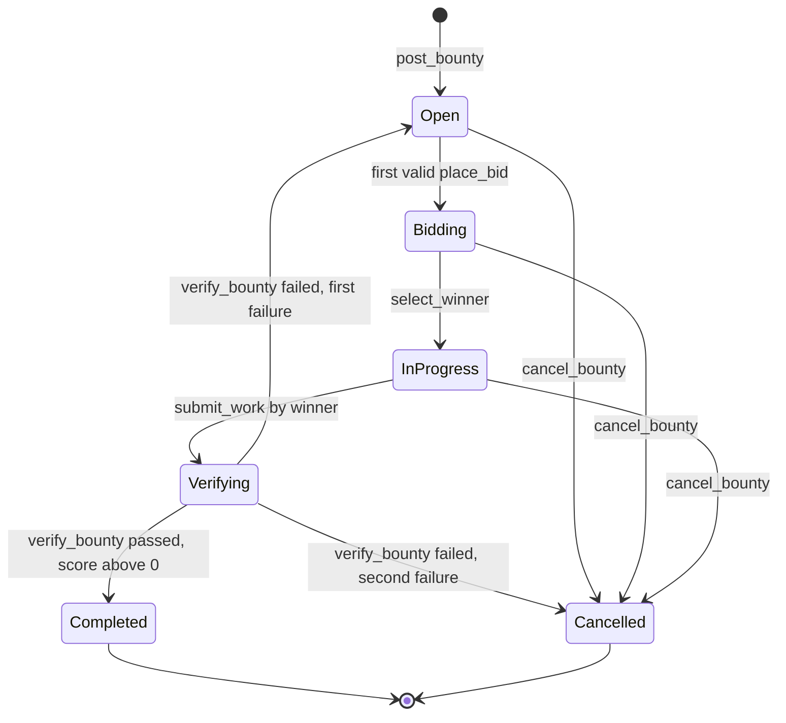

# HiveFund specification

This file describes the deployed code: `contracts/bounty-hub` v0.1.0 and `contracts/hive-token`, built with near-sdk 5.30.1. The market rules in plain language are in [`RULES.md`](../RULES.md), and the token and treasury math is in [`MECHANICS.md`](MECHANICS.md).

## 1. Data model (bounty-hub)

All amounts are yoctoNEAR (`U128`, which serializes to JSON as a string). IDs, timestamps (ms), tier, score and round are JSON numbers.

```rust
enum BountyStatus { Open, Bidding, InProgress, Verifying, Completed, Disputed /* reserved, never entered */, Cancelled }
enum BidStatus    { Pending, Rejected, Won, Lost, Superseded, Failed, Paid }

struct Bounty {
  id: u64, title: String /* ≤120 chars */, spec_hash: String /* 64 lowercase hex */, poster: AccountId,
  budget_yocto: U128, deadline_ms: u64, min_tier: u8 /* 1..=3 */, status: BountyStatus,
  round: u32 /* = failed verifications so far */, attempts: u32 /* failed verifications; 2 ⇒ Cancelled */,
  bid_ids: Vec<u64>, winner_bid_id: Option<u64>, deliverable_hash: Option<String>,
  check_results_hash: Option<String>, score: Option<u32>, excluded: Vec<AccountId>,
  created_ms: u64, updated_ms: u64, hive_minted: U128,
}

struct Bid {
  id: u64, bounty_id: u64, round: u32, worker: AccountId, tier: u8, price_yocto: U128, eta_ms: u64,
  signature: String /* "ed25519:<base58>" */, signed_payload: String /* canonical, built by the contract */,
  status: BidStatus, reject_reason: Option<String>, created_ms: u64,
}

struct WorkerInfo {
  account_id: AccountId, tier: u8, signing_pk: String /* "ed25519:<base58>" bid-signing key */, active: bool,
  completed: u32, failed: u32, total_score: u64, earned_yocto: U128, hive_earned: U128,
}
// get_reputation returns WorkerView = WorkerInfo + reputation: u32
// reputation = max(0, completed*10 + total_score/10 - failed*15)

struct ActivityEntry { id: u64, ts_ms: u64, block_height: u64, actor: AccountId, kind: ActivityKind,
  bounty_id: Option<u64>, bid_id: Option<u64>, amount: Option<U128>, detail: String /* ≤200 chars */ }

struct SupplyPoint { id: u64, ts_ms: u64, block_height: u64, bounty_id: u64, recipient: AccountId,
  bid_units: U128, score: u32, mint_rate: U128, amount: U128, total_minted_after: U128 }

struct Treasury { spend_cap: U128, committed_total: U128, funded_total: U128, available: U128,
  escrowed: U128, paid_out: U128, refunded_total: U128 }
// invariants: committed_total == escrowed + paid_out, committed_total <= spend_cap

struct PendingMint { bounty_id: u64, recipient: AccountId, amount: U128, bid_units: U128, score: u32 }

struct HubConfig { owner, coordinator: Option<AccountId>, verifier: Option<AccountId>, hive_token,
  mint_rate: U128, total_minted: U128, version: "0.1.0" }
```

Contract state:
- roles: `owner`, `coordinator`, `verifier`, `hive_token`;
- minting: `mint_rate`, `total_minted`;
- `treasury`;
- collections: `bounties: Vector<Bounty>` and `bids: Vector<Bid>` (the ID is the index), `workers: IterableMap<AccountId, WorkerInfo>`, `activity: Vector<ActivityEntry>`, `supply: Vector<SupplyPoint>`, `pending_mints: IterableMap<u64, PendingMint>`;
- `mints_in_flight: LookupSet<u64>`, a double-mint guard.

Limits:
- at most 30 bids per bounty (rejected bids count);
- `reject_bid` reasons and activity details are truncated to 200 characters.

## 2. Bounty state machine



`Disputed` exists in the enum but no method enters it in v0.1.

What happens to bids at each transition:
- **On `select_winner`:** the chosen bid becomes `Won`, and the round's other `Pending` bids become `Lost`.
- **On a failed verification:**
  - the winning bid becomes `Failed` and its worker is added to `excluded`;
  - `attempts` increases by 1;
  - if the bounty reopens, `round` increases by 1 and leftover `Pending` bids become `Superseded`.
- **On `cancel_bounty`:** `Pending` and `Won` bids become `Superseded`.
- **On a pass:** the winning bid becomes `Paid`.

## 3. Methods

Gas used by the agents: 30 TGas for every agent call, and 60 TGas for `verify_bounty`. The mint and its callback get 15 TGas each.

| Method | Caller | Effect / checks | Panics |
|---|---|---|---|
| `init(owner, hive_token_account, treasury_budget_yocto, mint_rate)` | deployer | `spend_cap = treasury_budget_yocto` | — |
| `fund_treasury()` payable | anyone | adds the deposit to `funded_total` and `available`; logs `TreasuryFunded` | `ERR_ZERO_DEPOSIT` |
| `set_coordinator(account_id)` / `set_verifier(account_id)` | owner | logs `RoleChanged` | `ERR_NOT_OWNER`, `ERR_ROLE_CONFLICT` (coordinator ≠ verifier, and neither can be a worker) |
| `add_worker(account_id, tier, signing_pk)` | owner | registers or updates a worker; logs `WorkerAdded` | `ERR_NOT_OWNER`, `ERR_BAD_TIER`, `ERR_BAD_HASH: signing_pk must be ed25519:<base58>`, `ERR_ROLE_CONFLICT` |
| `remove_worker(account_id)` | owner | `active = false`; logs `WorkerRemoved` | `ERR_NOT_OWNER`, `ERR_NOT_WORKER` |
| `set_mint_rate(mint_rate)` | owner | changes the rate for future mints | `ERR_NOT_OWNER` |
| `post_bounty(title, spec_hash, budget_yocto, deadline_ms, min_tier) -> u64` | owner or coordinator | moves the budget from `available` to `escrowed`; logs `BountyPosted` | `ERR_NOT_POSTER`, `ERR_TOO_LONG`, `ERR_BAD_HASH`, `ERR_BAD_TIER`, `ERR_TREASURY_INSUFFICIENT` (budget is 0 or above available), `ERR_SPEND_CAP`, `ERR_DEADLINE_PAST` |
| `place_bid(bounty_id, price_yocto, eta_ms, signature) -> u64` | active registered worker | builds and stores the canonical payload and the signature. A valid bid becomes `Pending` and the bounty goes to `Bidding` (logs `BidPlaced`). A business-rule violation is stored as a `Rejected` bid with a reason (logs `BidRejected`) and **does not panic** (see the list below the table) | `ERR_NOT_WORKER`, `ERR_TOO_MANY_BIDS`, `ERR_BOUNTY_NOT_FOUND`, `ERR_TOO_LONG` |
| `reject_bid(bounty_id, bid_id, reason)` | coordinator | `Pending` → `Rejected`; logs `BidRejected` (used for invalid signatures) | `ERR_NOT_COORDINATOR`, `ERR_BID_NOT_SELECTABLE` |
| `select_winner(bounty_id, bid_id)` | coordinator | the bounty must be `Bidding` and the bid `Pending` in the current round; logs `WinnerSelected` | `ERR_NOT_COORDINATOR`, `ERR_BAD_STATUS`, `ERR_BID_NOT_SELECTABLE` |
| `submit_work(bounty_id, deliverable_hash)` | the winning worker | `InProgress` → `Verifying`; logs `WorkSubmitted` | `ERR_NOT_WINNER`, `ERR_BAD_STATUS`, `ERR_BAD_HASH` |
| `verify_bounty(bounty_id, passed, score, check_results_hash) -> PromiseOrValue<()>` | verifier | stores the hash and score. **Pass** (`passed && score > 0`): `Completed`, treasury debited, payout transfer (`Payout`), `VerificationPassed`, reputation updated, `PendingMint` created, returns the mint promise. **Fail:** `VerificationFailed`, then either reopen (`BountyReopened`) or cancel (`BountyCancelled`, `TreasuryRefund`) | `ERR_NOT_VERIFIER`, `ERR_BAD_STATUS`, `ERR_BAD_SCORE` (score > 100), `ERR_BAD_HASH`, `ERR_OVERFLOW` |
| `on_mint_complete(bounty_id, recipient, amount, bid_units, score)` `#[private]` | callback | **success:** `total_minted += amount`, pushes a `SupplyPoint`, sets `bounty.hive_minted` and `worker.hive_earned`, logs `Mint`. **failure:** logs `MintFailed` and keeps the `PendingMint`. Never panics on the failure path | — |
| `retry_mint(bounty_id) -> Promise` | owner | re-issues a pending mint | `ERR_NOT_OWNER`, `ERR_NO_PENDING_MINT`, `ERR_BAD_STATUS: mint already in flight` |
| `cancel_bounty(bounty_id)` | owner or coordinator | `Open`/`Bidding`/`InProgress` → `Cancelled`; the budget returns to the treasury | `ERR_NOT_COORDINATOR: only owner or coordinator may cancel`, `ERR_BAD_STATUS` |

`place_bid` stores a `Rejected` bid instead of panicking in these cases:
- `"bounty closed"`: the bounty is not `Open` or `Bidding`;
- `"deadline passed"`;
- `"price exceeds budget"`;
- `"tier below min_tier"`;
- `"worker excluded"`;
- `"duplicate bid this round"`.

Every panic message **starts with** its `ERR_*` code, so tests match on `includes("ERR_…")`.

Views:
- `get_config()`
- `get_bounties(from_index?, limit?)` (default 0, 50)
- `get_bounty(bounty_id)`
- `get_bids(bounty_id)`
- `get_treasury()`
- `get_reputation(account_id?)`: all workers, including `signing_pk`
- `get_activity_log(from_index?, limit?)` (default limit 100)
- `get_supply_history(from_index?, limit?)`
- `get_pending_mints()`

### hive-token

| Method | Caller | Notes |
|---|---|---|
| `new(owner_id, minter_id)` | deployer | metadata `ft-1.0.0`, name "HiveFund Token", symbol `HIVE`, 18 decimals |
| `mint(account_id, amount)` | minter only (the hub) | registers the receiver if needed (the token account pays storage), deposits the amount, emits `FtMint` (memo "bounty reward"). Panics `ERR_NOT_MINTER`, `ERR_ZERO_AMOUNT` |
| `set_minter(minter_id)` | owner | hands the minter role over, e.g. for a hub upgrade; it is not a way to mint. `ERR_NOT_OWNER` |
| `get_minter()`, `get_owner()` | view | |
| NEP-141 / NEP-145 / metadata | standard | `ft_transfer`, `ft_transfer_call`, `ft_balance_of`, `ft_total_supply`, `storage_*`, `ft_metadata` |

Decay is not built. It is a `TODO(decay, cut #2)` in `hive-token/src/lib.rs`.

## 4. Roles and keys (as deployed)

| Account | Hub role | Function-call key: receiver → methods | Allowance |
|---|---|---|---|
| `hivefund-2026.testnet` | owner | full access (human) | — |
| `coordinator.hivefund-2026.testnet` | coordinator | `hub.` → `post_bounty`, `select_winner`, `reject_bid`, `cancel_bounty` | 0.05 NEAR |
| `verifier.hivefund-2026.testnet` | verifier | `hub.` → `verify_bounty` | 0.05 NEAR |
| `cheap.` / `quality.` / `adaptive.` / `forger.hivefund-2026.testnet` | workers (tiers 1 / 3 / 2 / 1) | `hub.` → `place_bid`, `submit_work` | 0.05 NEAR each |

Two layers enforce the roles:
1. **Access keys.** A function-call key cannot call methods outside its list: "Access key does not allow method X".
2. **The contract.** It checks the predecessor account (`ERR_NOT_VERIFIER`, `ERR_NOT_COORDINATOR`, `ERR_NOT_WORKER`, …).

The setup script's self-check tests both layers on testnet; results are in `config/deployment.testnet.json`. Function-call keys cannot attach a deposit, so `fund_treasury` comes from the owner or a wallet.

Recovery key: each agent account also carries root's public key, which the human holds. `scripts/topup.ts rekey <agent>` uses it to install a fresh function-call key when an allowance runs out. Agent processes only ever load their own function-call key from `.env.local`.

## 5. Bid signature scheme

A bid is a portable commitment, signed by the worker's **bid-signing key**. This key is separate from the transaction key, and its public half is registered on-chain as `signing_pk`.

Canonical payload: keys sorted, no whitespace, price as a string. The contract (`bid_payload` in `lib.rs`) and TypeScript (`bidPayload` in `agents/shared/src/bid.ts`) must produce the same bytes:

```
{"bounty_id":<u64>,"contract":"<hub account>","eta_ms":<u64>,"price_yocto":"<u128>","round":<u32>,"worker":"<account>"}
```

Golden vector (`tests/vectors/bid_payload.json`). Both the Rust and TypeScript tests assert against it:

```
{"bounty_id":7,"contract":"hub.hivefund-demo.testnet","eta_ms":3600000,"price_yocto":"500000000000000000000000","round":1,"worker":"cheap.hivefund-demo.testnet"}
```

The signature is `"ed25519:" + base58(64-byte signature over the UTF-8 payload)`.

How a bid is checked:
- The contract stores both `signed_payload` and `signature`. It does **not** verify the signature itself.
- The coordinator rebuilds the payload, checks it equals `signed_payload`, and verifies the signature against `signing_pk` from `get_reputation`.
- If either check fails, the coordinator calls `reject_bid(…, "invalid bid signature")`. The forgery then stays in the on-chain log instead of disappearing in a reverted transaction.
- The dashboard runs the same verification in the browser.

## 6. Off-chain objects and content addressing

Every object is stored as `canonicalize(obj)`: sorted keys, no whitespace. bigint, undefined and NaN are rejected. The address is `hash = sha256_hex(canonical bytes)`, and the file is `data/offchain/<hash>.json`. A reader re-hashes the file and rejects any mismatch. The on-chain fields that refer to these objects are `spec_hash`, `deliverable_hash` and `check_results_hash`.

| kind | Shape (TypeScript, `agents/shared/src/types.ts`) | Referenced by |
|---|---|---|
| `spec` | `BountySpec { version: 1, title, description, deliverable_schema (JSON Schema), required_sections[], test: {runner:"node", file, timeout_ms} \| null, rubric: {criteria[{id, description, weight}], pass_threshold}, budget_yocto, min_tier, deadline_minutes, procurement?: ProcurementSpec }` | `Bounty.spec_hash` |
| `deliverable` | `Deliverable { bounty_id, round, worker, sections{}, data, code?{filename: source}, generator?: {mode: "llm"\|"template"\|"failed", model} }` | `Bounty.deliverable_hash` |
| `report` | `VerificationReport { bounty_id, round, worker, spec_hash, deliverable_hash, checks[{id: schema\|sections\|test\|catalog\|delivery\|rubric, passed, skipped?, details, duration_ms}], rubric: {mode: llm\|fallback, model, scores[{criterion, score, rationale}], total, threshold} \| null, passed, score, verifier, created_ms, procurement?: ProcurementEvidence }` | `Bounty.check_results_hash` |
| `selection` | `SelectionRationale { bounty_id, round, weights, candidates[{bid_id, worker, price_yocto, eta_ms, reputation, sig_valid, score}], winner_bid_id, rejected[{bid_id, reason}] }` | indexed by bounty and round in `index.jsonl` |

### Procurement shapes

Optional and backward compatible: specs, deliverables and reports without them behave as before. Source of truth: `agents/shared/src/types.ts` and `docs/notes/procurement.md`.

```ts
ProcurementSpec {
  catalog: "nearai-models";                 // NEAR AI Cloud GET /v1/models
  catalog_url: string;                      // https://cloud-api.near.ai/v1/models
  currency: "USD";
  product_budget_usd: number;               // max workload cost of the pick
  workload: { input_mtok: number; output_mtok: number };
  requirements: {
    supported_features?: string[];          // e.g. ["tools", "structured_outputs"]
    min_context_length?: number;
    input_modalities?: string[];
    output_modalities?: string[];
  };
  price_tolerance_pct: number;              // 0..50, relative, per price component
  delivery_check: boolean;                  // verifier makes one tiny real call to the pick
}

// Deliverable for a procurement bounty: sections {summary, comparison, recommendation} (markdown).
// data, JSON Schema $id "hivefund:procurement-v1":
{
  item_id: string;                          // catalog id of the pick
  source_url: string;                       // catalog_url + "#" + encodeURIComponent(item_id)
  quoted_pricing: { input: number; output: number };   // USD / 1M tokens, as the worker read it
  quoted_workload_cost_usd: number;
  catalog_fetched_at_ms: number;
  considered_count: number;                 // catalog entries scanned
  alternatives: { item_id: string; workload_cost_usd: number }[];   // 0..10
  justification: string;
}

ProcurementEvidence {                       // VerificationReport.procurement, hash-locked with the report
  catalog_url; fetched_at_ms; catalog_size; item_id; found;
  quoted_pricing: {input, output} | null; live_pricing: {input, output} | null; price_match;
  quoted_workload_cost_usd | null; live_workload_cost_usd | null; budget_usd; within_budget;
  requirement_checks: { requirement; expected; actual; passed }[];
  compliant_count; cheapest_compliant: { id; workload_cost_usd } | null;
  delivery: { model; ok; http_status | null; prompt_tokens | null; completion_tokens | null; cost_usd | null; details } | null;
}
```

`CheckId = "schema" | "sections" | "test" | "catalog" | "delivery" | "rubric"`. For procurement specs the order is schema → sections → test (skipped) → catalog → delivery → rubric. `catalog` and `delivery` only appear on procurement reports.

Procurement fixtures live in `bounties/procurement/*.json` and are posted only with `npm run demo -- --bounties procurement`.

Other files in `data/`:
- `index.jsonl`: one row per stored object, `{hash, kind, bounty_id, round, actor, ts}`.
- `strategy/<worker>.jsonl`: one `StrategyChange` per line, `{ts_ms, worker, bounty_id, old_margin, new_margin, reason, window[]}`.
- `tx.jsonl`: one row per hub call, `{ts, actor, contract, method, args, txHash, ok, error?, explorer}`.
- `chain-state.json`: a snapshot of every view.

`data/sample/` is a labelled UI fixture (`"sample": true`); its tx hashes are `mock-<n>`.

## 7. Activity log kinds

| Kind | Emitted by |
|---|---|
| `TreasuryFunded` | `fund_treasury` |
| `RoleChanged` | `set_coordinator`, `set_verifier`, `set_mint_rate` |
| `WorkerAdded`, `WorkerRemoved` | `add_worker`, `remove_worker` |
| `BountyPosted` | `post_bounty` |
| `BidPlaced`, `BidRejected` | `place_bid` (valid or business rejection), `reject_bid` |
| `WinnerSelected` | `select_winner` |
| `WorkSubmitted` | `submit_work` |
| `VerificationPassed`, `Payout` | `verify_bounty` (pass) |
| `VerificationFailed`, `BountyReopened` | `verify_bounty` (fail, attempts < 2) |
| `BountyCancelled`, `TreasuryRefund` | `verify_bounty` (second fail), `cancel_bounty` |
| `Mint`, `MintFailed` | `on_mint_complete` |
| `DisputeOpened`, `DisputeResolved` | reserved, never emitted in v0.1 |

Each activity entry is also written to the transaction logs as `hivefund: <detail>`, so it shows up in the explorer.
